# Prepnova Education — Master Architectural Document

> **A zero-trust, freemium SAT preparation platform** built on Next.js 16 and Supabase. This document is the single source of truth for every data flow, security boundary, and architectural decision in the system.

> [!IMPORTANT]
> This is a living architectural reference — not a setup guide. It documents **how** and **why** every subsystem operates the way it does.

---

## Table of Contents

1. [System Architecture Overview](#1-system-architecture-overview)
2. [The Database Vault (Schema & Security)](#2-the-database-vault-schema--security)
3. [The Authentication & Authorization Pipeline](#3-the-authentication--authorization-pipeline)
4. [The Admin Engine (Data Management)](#4-the-admin-engine-data-management)
5. [The Adjacency List File System](#5-the-adjacency-list-file-system)
6. [The Adaptive Testing Engine](#6-the-adaptive-testing-engine)
7. [The Student Portal & Testing Environment](#7-the-student-portal--testing-environment)
8. [The Text Rendering Pipeline](#8-the-text-rendering-pipeline)
9. [Comprehensive File Directory](#9-comprehensive-file-directory)
10. [Local Setup & Web Deployment](#10-local-setup--web-deployment)

---

## 1. System Architecture Overview

The platform operates on a **three-layer architecture** where the Next.js server acts as a mandatory intermediary between all clients and the database. No client — student or admin — ever directly mutates the `questions` table.

```mermaid
flowchart TB
    subgraph CLIENT["Client Layer (Browser)"]
        LP["Landing Page<br/><code>/</code> · <code>/upgrade</code>"]
        AUTH["Auth Pages<br/><code>/login</code> · <code>/signup</code>"]
        DASH["Student Dashboard<br/><code>/dashboard</code> · <code>/dashboard/practice</code> · <code>/dashboard/classes</code> · <code>/dashboard/profile</code> · <code>/dashboard/history</code>"]
        QUIZ["Quiz Engine<br/><code>/quiz/[moduleId]</code>"]
        TEST["Adaptive & Demo Test Engine<br/><code>/test/[testId]</code> · <code>/test-demo/[testId]</code>"]
        ADMIN["Admin Panel & Owner Control<br/><code>/admin/*</code> (13+ tools) · <code>/admin/owner-control</code>"]
    end

    subgraph SERVER["Server Layer (Next.js 16)"]
        MW["Middleware<br/>(Auth + Tiered admin_level Gate)"]
        SA_QUIZ["quizActions.js<br/>(getSecureQuizData · submitQuiz)"]
        SA_TEST["testActions.js<br/>(startTest · submitModule · route)"]
        SA_BULK["bulkActions.js<br/>(upload · duplicates · hashes)"]
        SA_REHASH["rehashActions.js<br/>(scan · heal · bulk update hashes)"]
        SA_USER["adminUserActions.js & userUpgradeActions.js<br/>(users · plans · passwords · user levels)"]
        SA_BUG["bugActions.js<br/>(create · fetch · triage · bulk delete)"]
        SA_TEL["telemetryActions.js<br/>(track · aggregation · live analytics)"]
        SA_UPG["adminScheduledUpgradeActions.js<br/>(schedule · execute · popup upgrades)"]
        SA_MOD["moduleAssignmentActions.js<br/>(clean question-to-module assignments)"]
        SC["Server Components & API Routes<br/>(SSR data fetch · /api/telemetry/batch)"]
    end

    subgraph DB["Supabase (Postgres + Storage)"]
        PROFILES[("profiles<br/>(user_level · admin_level)")]
        QUESTIONS[("questions")]
        MODULES[("modules")]
        SUBMISSIONS[("submissions")]
        PRACTICE_TESTS[("practice_tests")]
        TEST_SUBMISSIONS[("test_submissions")]
        FILES[("files")]
        BUG_REPORTS[("bug_reports")]
        ADMIN_PERMS[("admin_tool_permissions")]
        SCHED_UPG[("scheduled_upgrades")]
        CLASSES[("classes & recordings")]
        TELEMETRY[("telemetry_events")]
        TOGGLES[("site_feature_toggles")]
        STORAGE[("Storage Bucket<br/>question_images")]
    end

    LP --> AUTH
    AUTH -->|"Server Action"| MW
    DASH -->|"SSR fetch (anon key)"| SC
    QUIZ -->|"Server Action (service key)"| SA_QUIZ
    TEST -->|"Server Action (service key)"| SA_TEST
    ADMIN -->|"Server Action (service key)"| SA_BULK
    ADMIN -->|"Server Action (service key)"| SA_REHASH
    ADMIN -->|"Server Action (service key)"| SA_USER
    ADMIN -->|"Server Action (service key)"| SA_BUG
    ADMIN -->|"Server Action (service key)"| SA_TEL
    ADMIN -->|"Server Action (service key)"| SA_UPG
    ADMIN -->|"Server Action (service key)"| SA_MOD

    MW -->|"validates session + admin_level ≥ 7"| SC
    SC -->|"anon key (RLS enforced)"| PROFILES
    SC -->|"anon key (RLS enforced)"| MODULES

    SA_QUIZ -->|"service_role key (bypasses RLS)"| QUESTIONS
    SA_QUIZ -->|"service_role key"| SUBMISSIONS
    SA_QUIZ -->|"service_role key"| PROFILES
    SA_TEST -->|"service_role key"| PRACTICE_TESTS
    SA_TEST -->|"service_role key"| TEST_SUBMISSIONS
    SA_BULK -->|"service_role key"| QUESTIONS
    SA_BULK -->|"service_role key"| STORAGE
    SA_REHASH -->|"service_role key"| QUESTIONS
    SA_USER -->|"service_role key"| PROFILES
    SA_BUG -->|"service_role key"| BUG_REPORTS
    SA_TEL -->|"service_role key"| TELEMETRY
    SA_UPG -->|"service_role key"| SCHED_UPG
    SA_MOD -->|"service_role key"| MODULES

    style CLIENT fill:#1e293b,stroke:#334155,color:#e2e8f0
    style SERVER fill:#0f172a,stroke:#1e3a5f,color:#e2e8f0
    style DB fill:#1a1a2e,stroke:#16213e,color:#e0e0e0
```

### Why Two Supabase Clients?

The system maintains two fundamentally different Supabase client types:

| Client Type | Initialized With | RLS Behavior | Used By | Location |
|---|---|---|---|---|
| **Anon Client** | `NEXT_PUBLIC_SUPABASE_ANON_KEY` | ✅ RLS enforced — user can only see their own data | Server Components, Middleware, Client Components | `utils/supabase/server.js`, `utils/supabase/client.js` |
| **Admin Client** | `SUPABASE_SERVICE_ROLE_KEY` | ❌ RLS bypassed — god-mode access to all tables | Server Actions only (`'use server'`) | `bulkActions.js`, `quizActions.js`, `adminUserActions.js`, `rehashActions.js`, `testActions.js`, `bugActions.js`, `telemetryActions.js`, `adminScheduledUpgradeActions.js`, `userUpgradeActions.js`, `moduleAssignmentActions.js` |

> [!CAUTION]
> The `SUPABASE_SERVICE_ROLE_KEY` is **never** exposed to the browser. It exists exclusively in `'use server'` files. If this key leaked to the client, an attacker could read, modify, or delete every question in the database. Every Server Action validates this key exists before executing: `if (!process.env.SUPABASE_SERVICE_ROLE_KEY) return { error: '...' }`.

### The Next.js Configuration

```javascript
// next.config.js
const nextConfig = {
  experimental: {
    serverActions: {
      bodySizeLimit: '50mb',
    },
  },
  serverActions: {
    bodySizeLimit: '50mb',  // Required for bulk JSON + image uploads
  },
  images: {
    remotePatterns: [
      { protocol: 'https', hostname: '*.supabase.co' }  // Allow Supabase Storage images
    ],
  },
};
```

**Why 50MB?** The Bulk Uploader sends a `FormData` payload containing a JSON blob (potentially thousands of questions) plus multiple SVG/PNG/JPG image files in a single atomic request. The default Next.js 1MB limit would reject these payloads. The `bodySizeLimit` is specified in **both** `experimental.serverActions` and top-level `serverActions` to ensure compatibility across all Next.js 16.x versions.

---

## 2. The Database Vault (Schema & Security)

### 2.1 Table Architecture

The database consists of **nine-plus core tables** (`profiles`, `questions`, `modules`, `submissions`, `practice_tests`, `test_submissions`, `files`, `bug_reports`, `admin_tool_permissions`, `scheduled_upgrades`, `classes`, `recordings`, `telemetry_events`, `site_feature_toggles`) with carefully designed relationships:

```mermaid
erDiagram
    PROFILES ||--o{ SUBMISSIONS : "student_id"
    MODULES ||--o{ SUBMISSIONS : "module_id"
    PROFILES ||--o{ TEST_SUBMISSIONS : "student_id"
    PRACTICE_TESTS ||--o{ TEST_SUBMISSIONS : "test_id"
    PROFILES ||--o{ BUG_REPORTS : "user_id"
    PROFILES ||--o{ SCHEDULED_UPGRADES : "user_id"
    PROFILES ||--o{ TELEMETRY_EVENTS : "user_id"
    CLASSES ||--o{ RECORDINGS : "class_id"
    PRACTICE_CONFIG ||--o{ PROFILES : "global settings"
    PRACTICE_CONFIG {
        integer id PK "Always 1"
        jsonb allowed_sources "DEFAULT []"
        integer level_1_limit "DEFAULT 10"
        integer level_2_limit "DEFAULT 100"
        integer level_3_limit "DEFAULT -1 (Unlimited)"
        integer level_4_limit "DEFAULT -1"
        integer level_5_limit "DEFAULT -1"
        integer level_6_limit "DEFAULT -1"
    }
    PROFILES {
        uuid id PK "References auth.users(id) ON DELETE CASCADE"
        text email UK "NOT NULL"
        text full_name
        text whatsapp_number
        text institution
        text academic_year
        boolean is_admin "DEFAULT FALSE"
        boolean is_premium "DEFAULT FALSE"
        integer user_level "DEFAULT 0 (0=Guest, 1=Free, 2-3=Practice, 4-5=Flash, 6-7=Master)"
        integer admin_level "DEFAULT 0 (7=Mod, 8=Admin, 9=Owner)"
        timestamptz premium_expires_at
        integer today_submitted "DEFAULT 0"
        timestamptz last_submission_date
        jsonb question_attempts "DEFAULT empty — O(1) Difficulty Engine state map"
        boolean has_claimed_practice_promo "DEFAULT FALSE"
        timestamptz created_at "DEFAULT NOW()"
    }
    QUESTIONS {
        text qid PK "Custom string keys e.g. bb_1_math_hard_q0001"
        text subject_tag "NOT NULL"
        text topic_tag "NOT NULL"
        text difficulty "CHECK Easy/Medium/Hard"
        text question_type "CHECK MCQ/SPR"
        text context "Passage or stimulus text"
        text question "NOT NULL"
        text image_url "Supabase Storage public URL"
        text option_a
        text option_b
        text option_c
        text option_d
        text correct_answer "NOT NULL"
        text correct_answer_explanation
        text question_source
        uuid_array assigned_modules "DEFAULT empty"
        text options_hash "SHA-256 basic fingerprint"
        text image_hash "SHA-256 pixel hash of image_url"
        text restructured_hash "SHA-256 extended fingerprint"
        boolean is_restructured_hash "DEFAULT FALSE"
        integer difficulty_rating "Computed avg expected rating (400-1600 scale)"
        integer attendee_count "DEFAULT 0 — rated students who attempted"
        integer unrated_attendee_count "DEFAULT 0 — unrated students who attempted"
        integer sum_of_expected_ratings "DEFAULT 0 — cumulative y contributions"
        timestamptz created_at "DEFAULT NOW()"
    }
    MODULES {
        uuid id PK "gen_random_uuid()"
        text module_name "NOT NULL"
        integer time_limit_minutes "NOT NULL"
        text difficulty "CHECK Easy/Medium/Hard/Mixed"
        boolean is_free "DEFAULT FALSE"
        text_array question_ids "DEFAULT empty"
        timestamptz created_at "DEFAULT NOW()"
    }
    SUBMISSIONS {
        uuid id PK "gen_random_uuid()"
        uuid student_id FK "References profiles(id)"
        uuid module_id FK "References modules(id)"
        integer total_questions "NOT NULL"
        integer correct_count "NOT NULL"
        integer score_estimate
        jsonb student_answers "Map of qid to answer"
        timestamptz submitted_at "DEFAULT NOW()"
    }
    PRACTICE_TESTS {
        uuid id PK "gen_random_uuid()"
        text test_name "NOT NULL"
        text test_type "CHECK READING_WRITING/MATH/BOTH"
        text_array subject_order "DEFAULT READING_WRITING, MATH"
        boolean is_free "DEFAULT FALSE"
        uuid rw_base_module_id FK
        uuid rw_easier_module_id FK
        uuid rw_harder_module_id FK
        integer rw_threshold
        uuid math_base_module_id FK
        uuid math_easier_module_id FK
        uuid math_harder_module_id FK
        integer math_threshold
        timestamptz created_at "DEFAULT NOW()"
    }
    TEST_SUBMISSIONS {
        uuid id PK "gen_random_uuid()"
        uuid student_id FK "References profiles(id)"
        uuid test_id FK "References practice_tests(id)"
        text rw_path "CHECK easier/harder"
        integer rw_base_correct
        integer rw_adaptive_correct
        integer rw_score_estimate
        text math_path "CHECK easier/harder"
        integer math_base_correct
        integer math_adaptive_correct
        integer math_score_estimate
        uuid rw_base_module_id "Module UUID taken for RW Base"
        uuid rw_adaptive_module_id "Module UUID taken for RW Adaptive"
        uuid math_base_module_id "Module UUID taken for Math Base"
        uuid math_adaptive_module_id "Module UUID taken for Math Adaptive"
        integer total_correct "Aggregate correct across all modules"
        integer total_questions "Aggregate question count across all modules"
        jsonb student_answers
        timestamptz submitted_at "DEFAULT NOW()"
    }
    FILES {
        uuid id PK "gen_random_uuid()"
        text name "NOT NULL"
        text type "CHECK folder/module/test"
        text parent_directory "NOT NULL"
        uuid reference_id "nullable FK"
        timestamptz created_at "DEFAULT NOW()"
    }
    BUG_REPORTS {
        uuid id PK "gen_random_uuid()"
        uuid user_id FK "References profiles(id) NULLable"
        text title "NOT NULL"
        text description "NOT NULL"
        text steps_to_reproduce
        text severity "CHECK Low/Medium/High/Critical"
        text status "CHECK open/in_progress/resolved/closed DEFAULT open"
        text page_url
        text user_agent
        text screenshot_url "Supabase Storage public URL"
        timestamptz created_at "DEFAULT NOW()"
    }
    ADMIN_TOOL_PERMISSIONS {
        uuid id PK "gen_random_uuid()"
        text tool_id UK "NOT NULL e.g. question-bank, module-builder"
        integer min_level_required "DEFAULT 8 (7=Mod, 8=Admin, 9=Owner)"
        text description
        timestamptz updated_at "DEFAULT NOW()"
    }
    SCHEDULED_UPGRADES {
        uuid id PK "gen_random_uuid()"
        uuid user_id FK "References profiles(id)"
        integer target_user_level "NOT NULL e.g. 6=Master"
        timestamptz upgrade_at "NOT NULL scheduled timestamp"
        boolean executed "DEFAULT FALSE"
        timestamptz executed_at
        timestamptz created_at "DEFAULT NOW()"
    }
    CLASSES {
        uuid id PK "gen_random_uuid()"
        text title "NOT NULL"
        text description
        text instructor_name "NOT NULL"
        timestamptz scheduled_at "NOT NULL"
        integer duration_minutes "DEFAULT 60"
        text meeting_url "Live streaming or room link"
        text status "CHECK upcoming/live/completed/cancelled"
        integer required_user_level "DEFAULT 0"
        timestamptz created_at "DEFAULT NOW()"
    }
    RECORDINGS {
        uuid id PK "gen_random_uuid()"
        uuid class_id FK "References classes(id)"
        text title "NOT NULL"
        text video_url "Vimeo/YouTube/Storage URL"
        text embed_code
        integer duration_seconds
        timestamptz recorded_at
        timestamptz created_at "DEFAULT NOW()"
    }
    TELEMETRY_EVENTS {
        uuid id PK "gen_random_uuid()"
        uuid user_id FK "References profiles(id) NULLable"
        text event_type "NOT NULL e.g. page_view, test_start, click"
        text path "Page path navigated"
        jsonb metadata "Extra event properties"
        timestamptz timestamp "DEFAULT NOW()"
    }
    SITE_FEATURE_TOGGLES {
        text feature_key PK "e.g. maintenance_mode, signup_enabled"
        boolean is_enabled "DEFAULT TRUE"
        integer min_access_level "DEFAULT 0"
        text description
        timestamptz updated_at "DEFAULT NOW()"
    }
```

### 2.2 The Bidirectional Sync Architecture

The relationship between `questions` and `modules` uses a **denormalized bidirectional array pattern** instead of a traditional junction table:

| Table | Column | Type | Contains |
|---|---|---|---|
| `modules` | `question_ids` | `TEXT[]` | Ordered list of QIDs assigned to this module |
| `questions` | `assigned_modules` | `UUID[]` | List of module UUIDs this question belongs to |

**Why not a junction table?** Three reasons:
1. **Order matters.** The `question_ids` array preserves the exact sequence of questions in a module. A junction table would require an additional `position` column and complex `ORDER BY` queries.
2. **Single-query access.** Fetching a module's questions is `SELECT * FROM questions WHERE qid = ANY(module.question_ids)` — no `JOIN` required.
3. **Scale.** With 10,000+ questions and dozens of modules, a junction table would contain hundreds of thousands of rows. Arrays keep the footprint minimal.

> [!WARNING]
> The trade-off is **sync responsibility**. When a question is assigned to a module, BOTH arrays must be updated atomically. The Module Builder handles this by updating `modules.question_ids` AND `questions.assigned_modules` in the same transaction. If only one side updates, the data becomes inconsistent.

### 2.3 The Dual-Hash Duplicate Detection System (V2)

The system uses a **dual-hash architecture** with four cryptographic hash columns to detect and manage duplicates:

| Column | Type | Purpose | When Populated |
|---|---|---|---|
| `options_hash` | TEXT | Base fingerprint of options/answers | Always (on upload and edit) |
| `image_hash` | TEXT | Pixel-level SHA-256 of the `image_url` context/reference image (generated server-side via `sharp`) | When question has an `image_url` |
| `restructured_hash` | TEXT | Extended fingerprint that includes `context` + `question` text in addition to options | Only when `is_restructured_hash = true` |
| `is_restructured_hash` | BOOLEAN | Flag that activates the restructured collision lane | Set via the Collision Resolver UI |

**Key architectural rule:** When `is_restructured_hash` is `true`, the duplicate detection system **ignores** `options_hash` collisions entirely and only checks for collisions on `restructured_hash`. This prevents false positives for questions that legitimately share the same answer options (e.g., common MCQ choices like "True/False" across different question stems).

**Hash Prefixes:** All hashes are prefixed with a type identifier to ensure cross-type collisions are impossible:

| Prefix | Meaning |
|---|---|
| `MCQ_` | Standard MCQ options hash |
| `SPR_` | Standard SPR answer hash |
| `REST_MCQ_` | Restructured MCQ hash |
| `REST_SPR_` | Restructured SPR hash |

The hashing algorithm differs by question type:

**MCQ Hash (Standard / `options_hash`):**
Options are sorted alphabetically and lowercased. If an option contains an image (`|| filename`), the filename is replaced with the **pixel hash** of that image before hashing.
```
MCQ_ + SHA-256( sort(options_lowercased_with_pixel_hashes).join('|') + '|' + correct_answer_text )
```

**MCQ Hash (Restructured / `restructured_hash`):**
```
REST_MCQ_ + SHA-256( sort(options_lowercased_with_pixel_hashes).join('|') + '|' + correct_answer_text + '|' + context_text + '|' + question_text )
```

**SPR Hash (Standard / `options_hash`) — Multi-Hash Array Expansion:**
The multiple possible correct answers are split by `||`. Fractions are **simplified to irreducible form** via GCD (e.g., `10/4` → `5/2`, `6/3` → `2/1`). Each unique acceptable answer then generates its **own independent hash**. All hashes are stored in-memory as the `all_options_hashes` array; the first hash is saved to the `options_hash` database column for indexed lookups.
```
For correct_answer = "-2 || 2":
  all_options_hashes = [
    SPR_ + SHA-256( "-2" ),
    SPR_ + SHA-256( "2" )
  ]
  options_hash (DB column) = all_options_hashes[0]
```
A collision is triggered if **any** hash in an incoming question's `all_options_hashes` matches **any** hash stored in the database or in the current upload batch. This ensures that a question with answer `"2"` will correctly collide with an existing question whose answer is `"-2 || 2"`.

**SPR Hash (Restructured / `restructured_hash`):**
Fractions are simplified via GCD, answers are sorted lexicographically and joined with `||`, then combined with the question text.
```
REST_SPR_ + SHA-256( question_text + '|' + sorted_simplified_answers.join('||') )
```

> [!NOTE]
> **Collision OR Condition:** A question is flagged as a collision if **EITHER** its `image_hash` collides **OR** its `options_hash` collides (or `restructured_hash` for restructured questions) with another question of the same type (intra-batch or in the database).

### 2.4 Row Level Security (RLS) Policies

RLS is enabled on **all seven tables**. The security model follows a zero-trust principle:

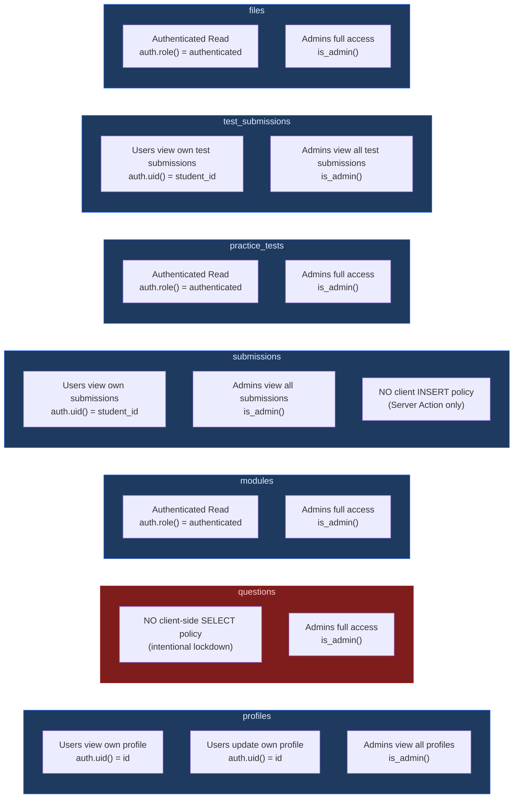

> [!CAUTION]
> **The `questions` table has NO `SELECT` policy for regular users.** This is the most critical security decision in the entire system. Without a policy, Supabase RLS blocks 100% of client-side `SELECT` queries. Students can ONLY access questions through the `getSecureQuizDataAction` Server Action, which uses the `service_role` key. This prevents:
> - Dumping the entire question bank via the browser console
> - Accessing premium questions without authorization
> - Reading correct answers before submitting

### 2.5 The `is_admin()` Security Definer Function

```sql
CREATE OR REPLACE FUNCTION public.is_admin()
RETURNS BOOLEAN
LANGUAGE sql
SECURITY DEFINER
SET search_path = public
STABLE
AS $$
  SELECT EXISTS (
    SELECT 1 FROM public.profiles
    WHERE id = auth.uid() AND is_admin = true
  );
$$;
```

**Why `SECURITY DEFINER`?** Without it, calling `is_admin()` inside an RLS policy on the `profiles` table would create infinite recursion — the policy needs to read `profiles` to check `is_admin`, but reading `profiles` triggers the policy, which calls `is_admin()` again. `SECURITY DEFINER` executes the function as the function owner (superuser), bypassing RLS for that single check. The `STABLE` modifier tells PostgreSQL the function returns the same result within a single transaction, allowing query-plan optimization.

### 2.6 Database Triggers

#### A) Auto-Profile Creation on Signup

```sql
CREATE TRIGGER on_auth_user_created
  AFTER INSERT ON auth.users
  FOR EACH ROW EXECUTE PROCEDURE public.handle_new_user();
```

When a user signs up via `supabase.auth.signUp()`, Supabase creates a row in `auth.users`. This trigger **automatically** copies the user's metadata (`full_name`, `whatsapp_number`, `institution`, `academic_year`) into a new `profiles` row. The frontend never needs to manually create a profile.

#### B) FIFO Submission Cleanup

```sql
CREATE TRIGGER on_submission_insert
  AFTER INSERT ON public.submissions
  FOR EACH ROW EXECUTE PROCEDURE handle_fifo_submissions();
```

This trigger enforces **storage limits** per user tier:

| User Tier | Max Stored Submissions | Behavior When Exceeded |
|---|---|---|
| Free | **2** | Oldest submission auto-deleted |
| Premium | **100** | Oldest submission auto-deleted |

The trigger fires AFTER every new submission insert. It counts the user's total submissions and deletes the oldest ones beyond the limit using `ORDER BY submitted_at DESC OFFSET max_limit`.

> [!NOTE]
> This is a **database-level** enforcement. Even if the application code had a bug that skipped cleanup, the trigger guarantees storage limits are respected. It's the final safety net.

### 2.7 Explicit Grants (Zero-Trust Permissions)

Beyond RLS policies, the schema uses explicit `GRANT` statements:

| Table | `authenticated` role | `service_role` |
|---|---|---|
| `questions` | `SELECT` only | Full CRUD |
| `modules` | `SELECT` only | Full CRUD |
| `profiles` | `SELECT`, `UPDATE` | Full CRUD |
| `submissions` | `SELECT` only | Full CRUD |

**Why explicit grants when RLS exists?** Defense in depth. Even if an RLS policy had a bug, the `GRANT` statements ensure `authenticated` users can never `INSERT`, `UPDATE`, or `DELETE` questions or modules directly. Only the `service_role` (used by Server Actions) has those permissions.

### 2.8 SQL Schema Files & Migration Architecture (`supabase/schema.sql` vs `supabase/profile_addons.sql`)

The database setup is separated across two authoritative SQL files in the `supabase/` directory to cleanly separate initial base schema bootstrapping from incremental feature migrations and analytics extensions:

| SQL Script File | Execution Role | Primary Scope | Key Schema Definitions & Migrations |
|---|---|---|---|
| **`supabase/schema.sql`** | Core Bootstrapper (Complete DDL) | Establishes the foundational relational engine, user triggers, and core content tables (`profiles`, `questions`, `modules`, `submissions`, `practice_tests`, `test_submissions`, `files`). | Defines `handle_new_user()` trigger on `auth.users`, `handle_fifo_submissions()` dynamic cleanup trigger (`100` rows for premium vs `2` rows for free), base RLS policies, explicit zero-trust `GRANT` statements for `service_role` and `authenticated`, plus helper security functions (`is_admin()` and `is_moderator()`). Also contains appended copies of feature toggles and content-DB columnar tracking (`analytics_daily_deltas`). |
| **`supabase/profile_addons.sql`** | Addon & Feature Migration Script | Runs on top of the base schema (or standalone on User DB / Project A instances) to inject user profile attributes, packages, permissions, and 4-tier sliding window analytics. | Executed via `ALTER TABLE profiles ADD COLUMN IF NOT EXISTS ...` (`avatar_url`, `latest_sat_rw`, `latest_sat_math`, `first_mock_sat_rw`, `first_mock_sat_math`, `weak_topics`, `user_level`, `admin_level`). Creates public package & command tables (`classes`, `admin_tool_permissions`, `site_feature_toggles`, `scheduled_upgrades`, `bug_reports`). Creates the complete **4-Tier Columnar Analytics & Telemetry Engine (User DB)** with 32 sliding window columns on `classes`, the `page_traffic_analytics` table across 16 fixed authoritative routes, `telemetry_sessions` active online pulse table, and atomic SQL procedures `increment_userdb_analytics()` and `prune_userdb_daily_deltas()`. |

### 2.9 The Dual-Database Split: User DB (Project A) vs. Content DB (Project B)

To decouple high-frequency student telemetry, session tracking, and user profile mutations from heavy, read-intensive question rendering and bulk ingestion workloads, the platform architecture implements a **Dual-Database Split across two isolated Supabase project instances (`Project A` and `Project B`)**:

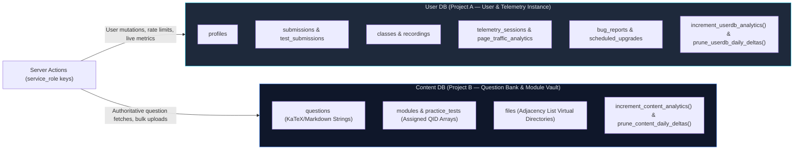

| Database Instance | Primary Purpose & Workload Type | Authoritative Tables Hosted | Specialized SQL Procedures & Telemetry Scope |
|---|---|---|---|
| **User DB (`Project A`)** | **High-Frequency Writes, Auth & Governance Vault**<br/>Handles all user authentication, daily rate limit counters (`today_submitted`), tier gating (`user_level`, `admin_level`), class streaming schedules, bug reports, and live page traffic analytics. | `profiles`, `submissions`, `test_submissions`, `classes`, `recordings`, `bug_reports`, `scheduled_upgrades`, `admin_tool_permissions`, `site_feature_toggles`, `telemetry_sessions`, `page_traffic_analytics` | Hosts the 32 columnar sliding window metrics across `classes` (`free_clicks_7d` through `master_seconds_all`) and `page_traffic_analytics`. Executed via `increment_userdb_analytics(table, id, metric, delta)` and pruned by `prune_userdb_daily_deltas()`. |
| **Content DB (`Project B`)** | **High-Volume Reads & Question Asset Vault**<br/>Houses the complete Digital SAT item bank (`questions`), custom modules, full practice tests, and virtual file structures. Isolated from user session spam to guarantee zero latency during high-concurrency exams. | `questions`, `modules`, `practice_tests`, `files` (Adjacency List) | Hosts the 32 columnar sliding window metrics across `practice_tests` and `modules` (`free_started_7d` through `master_submitted_all`). Executed via `increment_content_analytics(table, id, metric, delta)` and pruned by `prune_content_daily_deltas()`. |


---

### 2.10 The O(1) Question Difficulty Rating Engine (`difficultyEngineActions.js`)

To quantify per-question difficulty from live student performance data without expensive full-table aggregation queries, the platform implements an **Atomic O(1) Question Difficulty Rating Engine** (`app/actions/difficultyEngineActions.js`, 358 lines). The engine computes a proficiency-weighted Elo-style difficulty rating on the **400–1600 SAT composite scale** for every question in the Content DB.

#### A) The Rating Formula

When a student answers a question, the engine calculates an **expected rating contribution (y)** based on two variables:
1. **Student proficiency (X):** Derived from the student's latest SAT section scores (`profiles.latest_sat_rw` + `profiles.latest_sat_math`), scaled to the 400–1600 composite range via `deriveScaledProficiencyX()`. Students with no scores or composite below 950 are classified as **unrated (X = 0)** and contribute to `unrated_attendee_count` only — their attempts do not affect the global rating pool.
2. **Attempt state:** Tracks how many tries the student needed:

| Attempt State | Meaning | Expected Rating (y) |
|---|---|---|
| `state = 1` | Correct on 1st try | `clamp(X - 200, 400, 1600)` — question is easier than the student |
| `state = 2` | Correct on 2nd try | `clamp(X, 400, 1600)` — question matches the student |
| `state = 3` | Correct on 3rd try | `clamp(X + 200, 400, 1600)` — question is harder than the student |
| `state ≥ 4` or `state < 0` | Correct after 4+ tries or still unsolved | `clamp(X + 400, 400, 1600)` — question is significantly harder |

The global difficulty rating for each question is then:
```
difficulty_rating = round(sum_of_expected_ratings / attendee_count)
```

#### B) The Once-Solved Lock

Once a student correctly answers a question (`state > 0`), their attempt record is **permanently locked**. Subsequent re-attempts of the same question do not update the student's contribution or the global rating. This prevents rating manipulation through repeated correct answers.

#### C) Dual-Database Write Pattern

The engine performs writes to **both databases** in a single server action:

| Database | Table | Columns Updated | Purpose |
|---|---|---|---|
| **User DB (Project A)** | `profiles` | `question_attempts` (JSONB map: `{ qid: [state, y] }`) | Per-student attempt state and contribution tracking |
| **Content DB (Project B)** | `questions` | `attendee_count`, `unrated_attendee_count`, `sum_of_expected_ratings`, `difficulty_rating` | Global question-level difficulty aggregation |

#### D) Exported Server Actions

| Server Action | Parameters | Behavior |
|---|---|---|
| `recordItemAttemptO1Action` | `{ qid, isCorrect, subjectTag }` | Records a single question attempt. Called during practice quiz submissions and individual question checks. |
| `recordBatchAttemptsO1Action` | `{ attempts: [{ qid, isCorrect, subjectTag }] }` | Atomically records multiple attempts in a single batch. Fetches `profiles.question_attempts` once, processes all items in memory, writes the merged JSONB back once, then updates Content DB counters sequentially. Used during full test submissions. |

Both actions are imported and invoked by `quizActions.js` (practice module submissions) and `testActions.js` (adaptive test submissions) to ensure difficulty ratings update in real-time as students complete exercises.

> [!NOTE]
> The no-op optimization: If an unrated student (`X = 0`) fails the same question repeatedly, `yNew === prevY === 0` and only the User DB failure counter increments — the Content DB is not touched. This eliminates unnecessary cross-database writes for the most common repeated-failure scenario.

---

## 3. The Authentication & Authorization Pipeline

### 3.1 The Middleware Gatekeeper

Every HTTP request to a protected route passes through `middleware.js` before reaching any page component. The middleware operates as a **three-tier gate**:

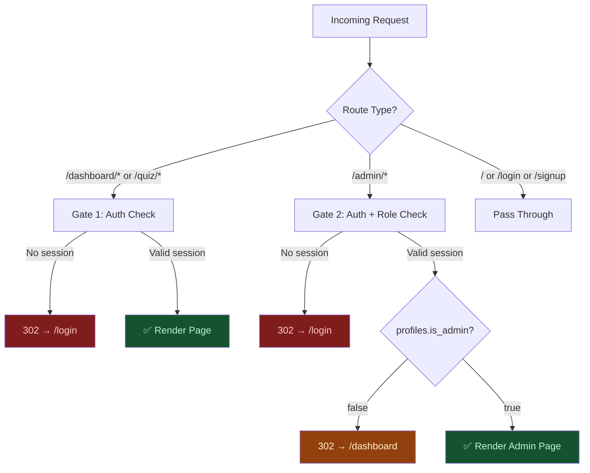

**Key implementation detail:** The middleware creates a Supabase client using the `anon_key` and calls `supabase.auth.getUser()` — not `getSession()`. This is critical because `getUser()` validates the JWT against Supabase's servers, while `getSession()` only reads from the local cookie (which could be forged).

For admin routes, the middleware performs a **second database query** checking both the legacy `is_admin` flag and the new `admin_level` integer hierarchy:
```javascript
const { data: profile } = await supabase
  .from('profiles')
  .select('is_admin, admin_level')
  .eq('id', user.id)
  .single()

const isAdmin = profile?.is_admin || (profile?.admin_level && profile.admin_level >= 7);
if (!isAdmin) {
  return NextResponse.redirect(new URL('/dashboard', request.url))
}
```

> [!IMPORTANT]
> The middleware path matcher explicitly excludes static assets: `/((?!_next/static|_next/image|favicon.ico|.*\.(?:svg|png|jpg|jpeg|gif|webp)$).*)`. Without this, every image request would trigger a database query — destroying performance.

### 3.2 The Signup Flow

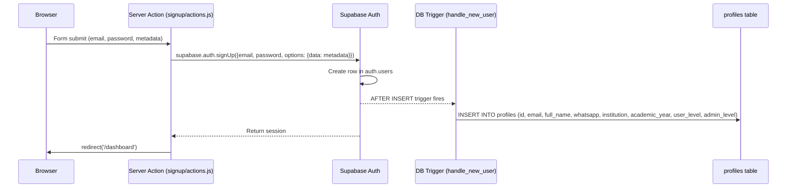

The signup collects five metadata fields beyond email/password: `full_name`, `whatsapp_number`, `institution`, and `academic_year`. These are stored in `auth.users.raw_user_meta_data` (JSONB) and automatically copied to the `profiles` table by the `on_auth_user_created` trigger alongside default `user_level = 1` and `admin_level = 0`.

> [!NOTE]
> There is **no email verification flow**. The system redirects directly to `/dashboard` after signup. There is also **no self-service password reset**. The login page explicitly states: *"Please contact the system administrator. Only admins can manually reset passwords."* This is enforced via the admin-only `forceChangePassword()` Server Action which calls `supabase.auth.admin.updateUserById()`.

### 3.3 The Premium Gatekeeper (Quiz Access Control)

When a student clicks "Start Practice" on a module, `getSecureQuizDataAction(moduleId)` executes a **four-stage security pipeline**:

| Stage | Check | Failure Response | Purpose |
|---|---|---|---|
| 1 | `session` exists | `LOGIN_REQUIRED` | Reject unauthenticated users |
| 2 | `module` exists in DB | `MODULE_NOT_FOUND` | Reject invalid/deleted module IDs |
| 3 | Module is `is_free` OR user `is_admin` OR `admin_level ≥ 7` | Skip premium check | Admins and moderators always have access |
| 4 | (User `is_premium` AND `premium_expires_at > now()`) OR `user_level ≥ 2` | `PREMIUM_REQUIRED` | Time-based premium and tiered user level validation |

**The Auto-Downgrade Check (Stage 4 detail):**
```javascript
let isPremium = profile?.is_premium || (profile?.user_level && profile.user_level >= 2);
if (profile?.is_premium && profile?.premium_expires_at) {
  if (new Date(profile.premium_expires_at) < new Date()) {
    isPremium = false;  // Expired — treat as free / reset level to 1
  }
}
```

This check runs at **three independent locations** for defense-in-depth:
1. `getSecureQuizDataAction()` — blocks quiz access
2. `dashboard/layout.jsx` — updates UI to show "Free Plan" vs "Master Tier"
3. `getUserDetails()` in `adminUserActions.js` — auto-downgrades in the database and resets expired `user_level`

### 3.4 Rate Limiting (Free User Submission Throttle)

Free users (`user_level ≤ 1` and not `is_premium`) are limited to **5 module submissions per day** (BST timezone). The `submitQuizAction` enforces this:

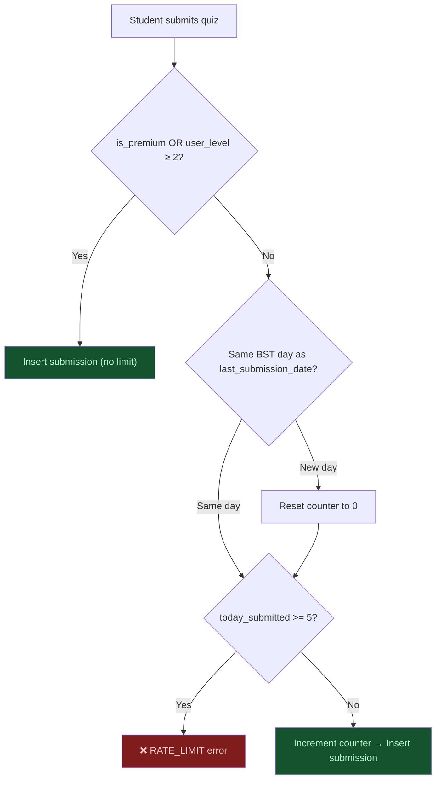

> [!NOTE]
> The timezone is hardcoded to **BST (UTC+6)** via manual offset calculation: `new Date(utcNow + (3600000 * 6))`. This ensures all users reset at midnight Bangladesh Standard Time regardless of their local timezone.

### 3.5 The Tiered User Level System (`user_level` & `admin_level`)

To provide granular, fine-tuned permission boundaries across student practice tiers and administrative access, the platform transitioned from simple boolean flags (`is_admin`, `is_premium`) to an integer-based **Tiered Level Architecture**. Both systems run concurrently for backward compatibility, with integer check logic taking precedence across Middleware, Server Actions, and Client Components.

#### A) Student Access Tiers (`user_level`: 0 to 7)

| Level Integer | Tier Name | Access Scope & Feature Permissions |
|---|---|---|
| `0` | **Guest / Unregistered** | Public landing page (`/`), `/upgrade` comparison page, and sample demo test via `/test-demo/[testId]`. Limited to 0 saved submissions in database via RLS and Server Action restrictions (`GuestRegistrationModal.jsx` prompts signup on save attempt). |
| `1` | **Free Account** | Standard registered student (`profiles` default). Access to `is_free = true` modules and practice tests (`/dashboard`). Subject to the **5 daily module submission limit** (BST timezone reset). Stored submission FIFO history capped at 2. |
| `2` – `3` | **Practice Tier** | Entry-level premium practice access (`/dashboard/practice`). Unlocks standard practice modules and removes daily submission rate throttling (`submitQuizAction` allows unlimited practice module attempts). |
| `4` – `5` | **Flash Tier** | Intermediate premium access. Unlocks full adaptive practice tests (`/test/[testId]`), live class stream viewing (`/dashboard/classes` via `ClassStreamerClient.jsx`), and detailed per-question explanation reviews (`/dashboard/history/[subId]`). |
| `6` – `7` | **Master Tier** | Full all-inclusive student access (`is_premium = true` equivalent). Unlocks all premium modules, all adaptive practice tests, high-priority bug reporting support, scheduled automated tier upgrades (`scheduled_upgrades`), and complete historical submission tracking up to 100 entries. |

#### B) Administrative Hierarchy (`admin_level`: 7 to 9)

| Level Integer | Role Title | Administrative Privileges |
|---|---|---|
| `< 7` (`0`–`6`) | **Standard Student** | No access to `/admin/*`. Automatically redirected to `/dashboard` by `middleware.js` and Server Action guards. |
| `7` | **Moderator (`Mod`)** | Entry-level administrative access. Can triage, view, and inspect the `/admin/bug-reports` board (`bugActions.js`) and browse/filter existing questions in `/admin/question-bank`. Cannot mutate user accounts or perform bulk uploads (`canAccess(toolId)` returns false for upload/user tools). |
| `8` | **Administrator (`Admin`)** | Full operational control over day-to-day platform data. Can access `/admin/users` (CRUD users, plan upgrades/downgrades via `updateUserPlan`, force password resets via `forceChangePassword`), `/admin/module-builder`, `/admin/test-builder`, `/admin/bulk-uploader`, `/admin/directory-manager`, `/admin/hash-rehash`, and `/admin/analytics`. |
| `9` | **Platform Owner (`Owner`)** | Unrestricted system-wide god-mode access. Exclusive access to **The Owner Control Room (`/admin/owner-control`)**, allowing dynamic modification of `admin_tool_permissions` (setting custom minimum level requirements per admin tool), site-wide feature toggles (`site_feature_toggles` / `FeatureMaintenanceGuard.jsx`), scheduled upgrade configurations (`ScheduledUpgradesTool.jsx`), and promotion/demotion of other Level 8 Admins. |

#### C) `getEffectiveUserLevel()` & Admin View Level Switcher

To allow developers and administrative staff (`admin_level ≥ 7`) to accurately test and verify what a specific student tier experiences (such as testing locked modules, previewing upgrade banners, or verifying rate limit triggers) without manually editing their own database row or logging out, the platform implements a dual-layer override mechanism:

1. **Admin View Level Switcher (`AdminViewLevelSwitcher.jsx`):** A floating interface element available only when `admin_level ≥ 7`. Admins can select an emulated level (e.g., "Emulate Level 1: Free" or "Emulate Level 0: Guest"). This override state is stored securely in browser session cookies (`emulated_user_level`) and passed directly via request headers.
2. **`getEffectiveUserLevel(profile, cookies)` Utility:** Every Server Action and SSR page component resolves access through this centralized function instead of inspecting `profile.user_level` directly:
```javascript
export function getEffectiveUserLevel(profile, requestCookies) {
  if (profile?.admin_level >= 7 && requestCookies?.get('emulated_user_level')) {
    return parseInt(requestCookies.get('emulated_user_level').value, 10);
  }
  return profile?.user_level ?? (profile?.is_premium ? 6 : 1);
}
```
This guarantees that when an Owner selects "Emulate Level 1", every component (`dashboard/layout.jsx`, `getSecureQuizDataAction`, `submitQuizAction`, `DashboardSidebarNav.jsx`) behaves exactly as if a genuine Free tier user initiated the request.

### 3.6 The Practice Question Quota System

Separate from the module submission limit (Section 3.4), the platform enforces a **per-tier question limit** exclusively for the Randomized Practice Engine (`/dashboard/practice`).

- **Global Configuration:** Limits are defined in the `practice_config` table (a single-row table with `id=1`), which maps each user level to a daily question quota (e.g., `level_1_limit: 10`, `level_2_limit: 100`, `level_3_limit: -1` for unlimited).
- **Irreversible Deduction:** Quotas are checked and deducted by `fetchPracticeQuestionsAction()` *before* the session starts. If a student requests 10 questions and has 10 quota remaining, those 10 questions are immediately marked as consumed in their `profiles.today_submitted` counter.
- **Custom Quota Modal:** When the limit is reached, instead of a native browser alert, the system mounts a dark-themed custom UI modal urging them to upgrade via `/upgrade`.
- **BST Timezone Reset:** Just like the module submission limit, the practice quota resets at midnight Bangladesh Standard Time (UTC+6). The logic compares the current BST date against `profiles.last_submission_date`.

---

## 4. The Admin Engine (Data Management)

The admin panel is a **monolithic component architecture** — the entire admin UI lives in a single ~4,389 line file (`AdminClient.jsx`) that exports **13+ major components** and three shared hash utility functions, working alongside dedicated sub-route client pages:

| Component / Tool | Export Type | Route | Minimum Level | Purpose |
|---|---|---|---|---|
| `AdminClient` | Default export | `/admin/*` | `7 (Mod)` | Central tab/layout container and tool router for all administrative views |
| `OwnerControlRoom` | Dedicated page / export | `/admin/owner-control` | `9 (Owner)` | Platform god-mode: tool permissions (`admin_tool_permissions`), feature toggles (`site_feature_toggles`), maintenance guards, and admin promotion |
| `AnalyticsDashboard` | Dedicated page / export | `/admin/analytics` | `8 (Admin)` | Telemetry metrics engine: MetricTicker, PageTrafficHeatmap, TestFunnelChart, and ClassEngagementMatrix (`telemetryActions.js`) |
| `BugReportsBoard` | Dedicated page / export | `/admin/bug-reports` | `7 (Mod)` | Comprehensive triage board for student bug reports (`bug_reports`), bulk selection/deletion, and severity filtering (`bugActions.js`) |
| `ScheduledUpgradesTool`| Dedicated page / export | `/admin/scheduled-upgrades` | `8 (Admin)` | Schedule future automated tier upgrades for user accounts (`scheduled_upgrades` table / `adminScheduledUpgradeActions.js`) |
| `ClassesClient` | Dedicated page / export | `/admin/classes` | `8 (Admin)` | Live class schedule creation, streaming links (`meeting_url`), and video recording embeds (`recordings` table) |
| `QuestionBank` | Named export | `/admin/question-bank` | `7 (Mod)` | Browse, search, filter, edit, and delete questions with full dual-hash validation |
| `ModuleBuilder` | Named export | `/admin/module-builder` | `8 (Admin)` | Create and configure modules, assign/reorder questions via multi-chunk drag-and-drop |
| `TestBuilder` | Named export | `/admin/test-builder` | `8 (Admin)` | Construct multi-stage adaptive practice tests (`practice_tests`) with custom Y routing thresholds |
| `BulkUploader` | Named export | `/admin/bulk-uploader` | `8 (Admin)` | Primary production JSON + images upload pipeline with 6-phase schema, asset, and collision validation |
| `BulkTester` | Standalone sub-route | `/admin/bulk-tester` | `8 (Admin)` | Sanitized staging environment for testing bulk upload pipelines without triggering hash collisions or DB mutation |

| `DirectoryManager` | Named export | `/admin/directory-manager` | `8 (Admin)` | Adjacency List virtual file system interface (`files` table) for organizing folders, modules, and tests on the student dashboard |
| `HashRehasher` | Standalone page | `/admin/hash-rehash` | `8 (Admin)` | Database-wide SHA-256 hash integrity scanner (`rehashActions.js`), collision resolution UI, and restructured hash healer |
| `UserManagement` | Named export | `/admin/users` | `8 (Admin)` | User CRUD, plan upgrades/downgrades (`updateUserPlan`), and force password resets (`forceChangePassword`) |
| `QuestionPreviewModal` | Named export | (shared) | `7 (Mod)` | Full SAT-style interactive question preview modal across all admin boards |

Additionally, four **utility functions** are exported for use by other pages (like `hash-rehash`):
- `generateHash(message)` — SHA-256 via Web Crypto API
- `getHashPrefix(question, isRestructured)` — Returns `MCQ_`, `SPR_`, `REST_MCQ_`, or `REST_SPR_`
- `getQuestionHashString(question, imageHashes, isRestructured)` — Builds the fingerprint string for hashing
- `getSprAnswerHashes(question, isRestructured)` — For SPR questions in basic mode, generates an array of independent `SPR_` SHA-256 hashes (one per acceptable answer after GCD fraction simplification). Returns `[]` for MCQ or restructured questions

Each admin sub-route has a thin Server Component page that fetches initial data via SSR, enforces tool permissions (`canAccess(toolId)`), then passes it to a `RouteWrappers.jsx` client component, which renders the corresponding `AdminClient` export.

### 4.1 The Bulk Uploader — Complete Upload Pipeline

The Bulk Uploader implements a **6-phase validation pipeline** that must pass sequentially before any data touches the database.

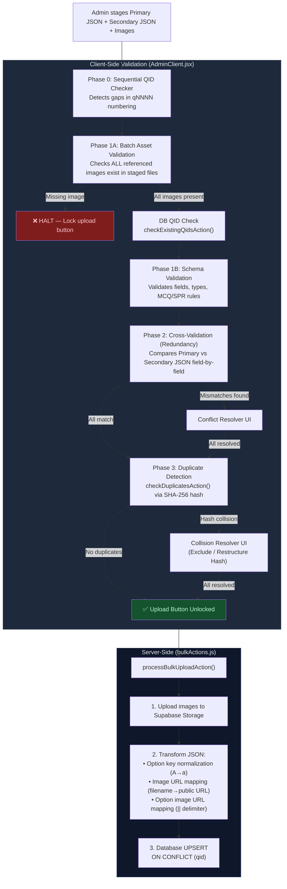

#### Phase 0 — Sequential QID Checker
Extracts the numeric suffix from each QID (e.g., `q0001` → `1`) and checks for gaps in the sequence. A gap suggests the external data pipeline missed a question. Issues warnings, not errors.

#### Phase 1A — Batch Asset Validation
Scans `image_url`, all four option fields (`option_a` through `option_d`), **and** the `correct_answer_explanation` field for image references. For options and explanations, it uses the `getOptionImages()` helper that detects two patterns:
- **`||` delimiter:** `"Some text || image_a.svg || image_b.jpg"` → extracts all filenames after delimiters
- **Pure image filename:** `"image_file.svg"` (no spaces, ends in image extension) → uses the whole string

Every extracted filename must exist in the staged `imageFiles[]` array. Missing images produce `[ERROR]` logs and **lock the upload button**. Conversely, any staged image file that is NOT referenced by the JSON is flagged as an `[ERROR] Orphaned Image` — preventing accidental leftover files from polluting the storage bucket.

> [!IMPORTANT]
> **Explanation Images:** The `correct_answer_explanation` field can contain inline diagram images appended via the `||` delimiter (e.g., `"The answer is... || qid_correct_answer_explanation_a.jpg"`). The validation engine and the server-side upload pipeline (`processMultipleImages()` in `bulkActions.js`) both handle these images identically to option images — replacing filenames with Supabase Storage public URLs.

#### Phase 1B — Schema Validation
Validates each question object against strict rules:

| Rule | MCQ | SPR |
|---|---|---|
| `correct_answer` | Must be `A`, `B`, `C`, or `D` | Can be any string (e.g., `"3.5"`, `"7/2"`) |
| `option_a` through `option_d` | Must not be empty strings | Must ALL be `null` or empty |
| Required fields | `qid`, `subject_tag`, `topic_tag`, `question` | Same |

#### Phase 2 — Cross-Validation (Redundancy Check)
Compares every field of every question in the Primary JSON against the Secondary JSON (an independent second extraction). Fields compared: `context`, `question`, `option_a`–`option_d`, `correct_answer`. Any mismatch triggers the **Conflict Resolver UI** — a side-by-side preview where the admin picks which version to keep.

#### Phase 3 — Duplicate Detection
Computes SHA-256 hashes for each incoming question via `getQuestionHashString()` and, for SPR questions, `getSprAnswerHashes()` to generate the `all_options_hashes` array (one independent hash per acceptable answer). These hashes are checked against both intra-batch questions and existing database records via `checkDuplicatesAction()`. For SPR questions, a collision triggers if **any** incoming answer hash intersects with **any** existing answer hash. Collisions can be resolved by either **excluding** the duplicate or marking it with `is_restructured_hash = true` (the "Restructure Hash" escape hatch, which adds `context` + `question` to the hash formula).

#### The Complex Option Image Pipeline (`||` Delimiter)

When the external data pipeline extracts an option containing an inline image (SVG graph, equation, etc.), it formats the option as:
```
"The graph shows a downward trend. || bb_1_math_hard_q0001_option_b.svg"
```

This flows through the system as follows:

| Stage | Value | Location |
|---|---|---|
| JSON provider output | `"Text || filename.svg"` | JSON file |
| Phase 1A validation | Extracts `filename.svg`, checks it exists in staged files | AdminClient.jsx |
| handleUpload() | Includes `filename.svg` in FormData `images` field | AdminClient.jsx |
| processBulkUploadAction | Uploads `filename.svg` to Storage, gets public URL | bulkActions.js |
| processOptionImage() | Replaces: `"Text || filename.svg"` → `"Text || https://...supabase.co/.../filename.svg"` | bulkActions.js |
| Quiz renderer | Splits on `||`, renders text via RichText + image via `` tag | quiz/[moduleId]/page.jsx |

### 4.2 The Question Bank — Filtering & Search Engine

The Question Bank implements **client-side filtering** on the full question set (fetched via paginated SSR). The filter state object:

```javascript
{
  search: '',        // Fuzzy match against qid OR context
  subject: '',       // Exact match: 'Math' | 'English'
  difficulty: '',    // Exact match: 'Easy' | 'Medium' | 'Hard'
  topic: '',         // Exact match against topic_tag
  assignment: 'All', // 'All' | 'Assigned' | 'Unassigned'
  sort: 'Newest',    // 'Newest' | 'Oldest' | 'Least Assigned'
  hasImage: 'All',   // 'All' | 'Yes' | 'No'
  source: ''         // Exact match against question_source
}
```

**Sort algorithms:**
- `Newest` — Default DB order (`created_at DESC`)
- `Oldest` — `new Date(a.created_at) - new Date(b.created_at)`
- `Least Assigned` — `a.assigned_modules.length - b.assigned_modules.length` (surfaces unassigned questions first)

**Edit flow with Dual-Hash Regeneration (`handleSave`):** When an admin edits any question field and saves, the system must regenerate all hashes before writing to the database:
1. Gathers all image URLs from the question (including option images)
2. Fetches pixel-level hashes from the server via `calculateImageHashesFromUrlsAction()`
3. Generates a fresh `newBasicHash` (`options_hash`). For SPR questions, also generates `all_options_hashes` via `getSprAnswerHashes()` (one independent hash per acceptable answer)
4. Generates a fresh `newRestHash` (`restructured_hash`)
5. Updates `image_hash` if the question has an `image_url`
6. Runs `checkDuplicatesAction()` against the database using a strict payload: `[{ qid, options_hash, all_options_hashes, restructured_hash, image_hash, is_restructured_hash }]`

> [!IMPORTANT]
> The `handleSave` duplicate evaluation logic relies on the `is_restructured_hash` flag. If the flag is true, the server action validates against `newRestHash` and ignores `newBasicHash`. This ensures the UI accurately catches "backdoor duplicates" even on restructured questions without triggering false positive `ReferenceErrors`.

### 4.3 The Module Builder — Question Assignment & Reorder System

The Module Builder has two modes:

**Assignment Mode:** A filterable question list with checkboxes. Selected questions are assigned to the active module via:
1. Append QIDs to `modules.question_ids` array
2. Append module UUID to each question's `assigned_modules` array
3. Both updates happen in sequence — this is the bidirectional sync

**Reorder Mode (`ModuleReorderEditor`):** A drag-and-drop interface with a **chunk system**:
- Questions can be split into up to **10 chunks** (visual groups)
- Individual questions are dragged between positions/chunks
- Entire chunks can be reordered by dragging the chunk header
- **Ctrl+Click** enables multi-select: multiple questions are dragged as a group
- On save, all chunks are flattened back to a single ordered array: `chunks.flat()`

**Enlarged View Workspace:** Because managing 50+ questions inside a standard container is difficult, the reorder editor features an **"Enlarge View"** mode.
- Clicking "Enlarge View" opens a **fullscreen modal workspace**.
- The interface widens, expanding the drag-and-drop droppables to fit the entire screen width.
- It provides a distraction-free, zero-scroll (or minimized-scroll) environment for complex multi-chunk reorganization.
- All state (chunks, sorts, selected items) is preserved seamlessly when entering or exiting the enlarged view.

**QID Sorting:** A dropdown in both the standard and enlarged reorder workspaces allows instant lexicographical sorting of all questions in the module:
- **A → Z (Small to Large):** `localeCompare` ascending
- **Z → A (Large to Small):** `localeCompare` descending

The sort preserves chunk boundaries — questions are gathered from all chunks, sorted globally, then redistributed back into their original chunk sizes.

> [!NOTE]
> The chunk system is purely a UI organizational tool. The database always stores a single flat `TEXT[]` array. Chunks exist only in React state to help admins visually manage large question sets (30+ questions).

### 4.4 User Management — Plan & Security Controls

| Action | Server Action | Mechanism |
|---|---|---|
| View all users | `getLightweightUsers()` | `SELECT id, email, full_name, is_admin, is_premium, premium_expires_at, today_submitted, last_submission_date` |
| View user details | `getUserDetails(userId)` | Full profile fetch + **auto-downgrade check** + practice quota usage display |
| View submission history | `getUserActivity(userId)` | Submissions JOIN modules for module names |
| Upgrade to Premium | `updateUserPlan(userId, true, expiresAt)` | Sets `is_premium = true` + mandatory expiration date |
| Downgrade to Free | `updateUserPlan(userId, false, null)` | Clears `is_premium` and `premium_expires_at` |
| Force password reset | `forceChangePassword(userId, newPassword)` | `supabase.auth.admin.updateUserById()` |
| Batch delete questions | `deleteQuestionsAction(qidsArray)` | `DELETE FROM questions WHERE qid IN (...)` |

**The Auto-Downgrade Engine:** `getUserDetails()` performs a server-side check on every admin view:
```javascript
if (data.is_premium && data.premium_expires_at) {
  if (new Date(data.premium_expires_at) < new Date()) {
    await supabaseAdmin.from('profiles')
      .update({ is_premium: false, premium_expires_at: null })
      .eq('id', userId)
  }
}
```
This means expired premium users are automatically downgraded the moment an admin views their profile — even if the user hasn't logged in.

### 4.5 The Hash Rehash Scanner (`/admin/hash-rehash`)

A dedicated administrative tool for **database-wide hash integrity maintenance**. This is a standalone page (not part of `AdminClient.jsx`) that imports the hash utilities and operates independently.

**Capabilities:**
- **Full Scan:** Downloads every question from the database in batches of 50, recomputes all hashes (`options_hash`, `restructured_hash`, `image_hash`) from scratch, and detects intra-database collisions
- **Heal Restructured Hashes:** Scans all `is_restructured_hash = true` questions, ensures `restructured_hash` is properly populated, and recalculates `options_hash` independently
- **Conflict Resolution:** When a collision is found mid-scan, the scanner pauses and presents a side-by-side comparison UI. The admin can choose to **Delete** one of the duplicates or **Restructure** its hash
- **Batch Uploads:** Accumulates hash updates in memory and flushes to the database in batches of 50 via `bulkUpdateHashesAction()`

### 4.6 The Directory Manager (File System UI)

The `DirectoryManager` component (part of the Admin UI) is the visual interface for the Adjacency List File System. It operates much like a desktop file explorer:

- **Breadcrumb Navigation:** Maintains an absolute path state (e.g. `/root/math/algebra`) and displays it as a clickable breadcrumb trail.
- **Folder Creation:** Injects new `folder` type rows into the `files` table, adopting the current absolute path as the `parent_directory`.
- **Entity Linking:** Admins can link existing Modules or Practice Tests into the current folder. This creates a `module` or `test` type row in the `files` table and sets the `reference_id` to the actual UUID of the Module/Test.
- **Traversal:** Double-clicking a folder simply updates the React state to the new `parent_directory` path and triggers a fresh SSR-like data fetch from the `files` table. No complex recursive database queries are needed.

### 4.7 The Bug Reporting System (`bug_reports` & Triage Board)

To capture actionable student feedback directly during practice tests, module exercises, and dashboard interaction, the platform integrates an end-to-end **Bug Reporting Pipeline** spanning student capture modals (`ReportBugModal.jsx`), floating submission triggers (`FloatingBugReportButton.jsx`), and an administrative triage management suite (`BugReportsBoard.jsx` inside `AdminClient.jsx` powered by `bugActions.js`).

#### A) Student Capture & Automated Contextualualization (`ReportBugModal.jsx`)
When a student encounters an issue (such as a typo in a passage, an incorrectly rendered SVG image, or an unexpected submission error), clicking the floating bug icon opens `ReportBugModal.jsx`. The modal automatically gathers vital diagnostic metadata without requiring manual student input:
- **Exact Page Context (`page_url`):** Captures `window.location.pathname` plus URL search parameters (e.g., identifying exact `qid` or `moduleId`).
- **Browser Environment (`user_agent`):** Records device OS, browser engine, and viewport dimensions (`navigator.userAgent`).
- **Screenshot Attachment (`screenshot_url`):** Students can upload a visual screenshot directly to the `bug-screenshots` Supabase Storage bucket.
- **Severity Rating (`severity`):** Student selects `Low` (minor cosmetic/typo), `Medium` (confusing wording), `High` (broken image/math calculation), or `Critical` (cannot submit answer / page crash).

#### B) Administrative Triage Board (`/admin/bug-reports`)
Accessible to Moderators (`Level 7+`), the triage board displays all reports organized in a filterable, multi-column Kanban or table layout:

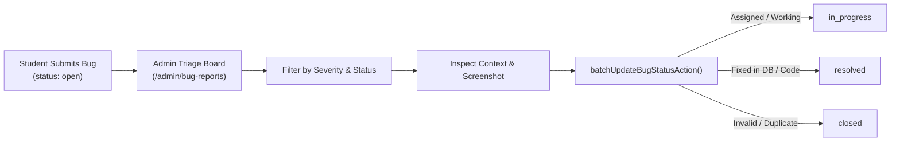

- **Bulk Management Actions:** Admins can select multiple bug reports simultaneously via checkboxes to execute `batchUpdateBugStatusAction(bugIds, newStatus)` or permanently purge obsolete reports via `batchDeleteBugsAction(bugIds)`.
- **Direct Question Jump:** If the bug report URL references a specific `qid`, the triage board renders a direct action link that opens the `QuestionPreviewModal` or navigates to `/admin/question-bank` with that QID pre-filtered for instant editing.

### 4.8 The Telemetry & Analytics Engine (`telemetry_events` & Live Metrics)

The platform incorporates a non-blocking, asynchronous **Telemetry & Analytics Engine** that tracks granular user interaction data without degrading frontend rendering speeds or disrupting active exam timers.

#### A) Client-Side Event Capture (`TelemetryProvider.jsx` & `TelemetrySync.jsx`)
The `TelemetryProvider` context wrapper wraps the root application hierarchy (`app/layout.jsx`). It listens for critical user events and buffers them in memory before dispatching batch POST requests to server-side telemetry handlers (`telemetryActions.js`):
- **Page Navigation (`page_view`):** Captures entry timestamps, referrer routes, and active `user_level`.
- **Test Lifecycle (`test_start`, `test_section_complete`, `test_finish`):** Records exact time spent per adaptive stage.
- **Interaction Hotspots (`click` & `module_attempt`):** Logs engagement with practice module cards, Desmos calculator toggles, and answer option changes.

#### B) Real-Time Administrative Dashboard (`/admin/analytics`)
Accessible to Administrators (`Level 8+`), the Analytics Dashboard (`AnalyticsDashboard.jsx` in `AdminClient.jsx`) aggregates raw event streams from the `telemetry_events` table into four interactive diagnostic widgets:

| Metric Widget | Data Source & Calculation Logic | Administrative Utility |
|---|---|---|
| **MetricTicker** | Counts distinct active `user_id` sessions within the last 15 minutes alongside total submissions (`submissions` + `test_submissions`) for the current BST calendar day. | Provides real-time pulse of platform traffic and concurrent exam load during peak practice hours. |
| **PageTrafficHeatmap** | Aggregates `path` occurrences from `telemetry_events` over customizable rolling windows (24h, 7d, 30d). | Highlights most visited study modules and identifies underutilized curriculum sections. |
| **TestFunnelChart** | Tracks student progression from `test_start` → `rw_base` completion → `math_base` completion → final `test_finish`. | Pinpoints exact drop-off stages where students abandon practice tests due to difficulty or time constraints. |
| **ClassEngagementMatrix**| Joins `telemetry_events` (event_type: `class_watch`) with `classes` and `recordings`. | Measures student attendance rates in live streams versus post-class video replay durations. |

### 4.9 The Classes System (Admin Management & Recordings)

To support live online tutoring, scheduled lecture streams, and an on-demand video recording library, the platform implements the **Classes System** across `classes` and `recordings` database tables, managed via `/admin/classes` (`ClassesClient.jsx`).

#### A) Live Session Configuration & Stream Routing
Administrators (`Level 8+`) can schedule upcoming live sessions by configuring:
- **Class Metadata:** `title`, `description`, `instructor_name`, and `scheduled_at` (BST exact timestamp).
- **Stream Room Link (`meeting_url`):** Embeds Zoom, Google Meet, or custom HLS video stream room URLs.
- **Level-Based Access Gating (`required_user_level`):** Admins specify exact minimum tier access (e.g., setting `required_user_level = 4` gates the live session exclusively to Flash and Master tier students).
- **Status Lifecycle (`status`):** Manually or automatically transitions between `upcoming` → `live` → `completed` (or `cancelled`).

#### B) Video Recording Archive (`recordings` Table)
Once a live class concludes (`status = 'completed'`), admins can attach one or more permanent video recordings to the class record (`recordings` table linked via `class_id`):
- Supports direct video URLs (`video_url`) from Vimeo, YouTube, or Supabase Storage, alongside full iframe `embed_code` blocks.
- When students navigate to `/dashboard/classes`, `ClassStreamerClient.jsx` validates their `user_level >= required_user_level` via Server Actions before mounting the secure video player interface.

### 4.10 The Scheduled Upgrades System (`scheduled_upgrades` & Popups)

To automate promotional promotions, scholarship distributions, or delayed account tier upgrades without requiring manual intervention precisely at midnight, the platform provides the **Scheduled Upgrades System** (`/admin/scheduled-upgrades` via `ScheduledUpgradesTool.jsx` in `AdminClient.jsx` and `adminScheduledUpgradeActions.js`).

#### A) Automated Execution Architecture
Instead of relying on fragile external cron jobs that can fail during server restarts, scheduled upgrades use a **Lazy-Evaluation Gatekeeper Pattern**:

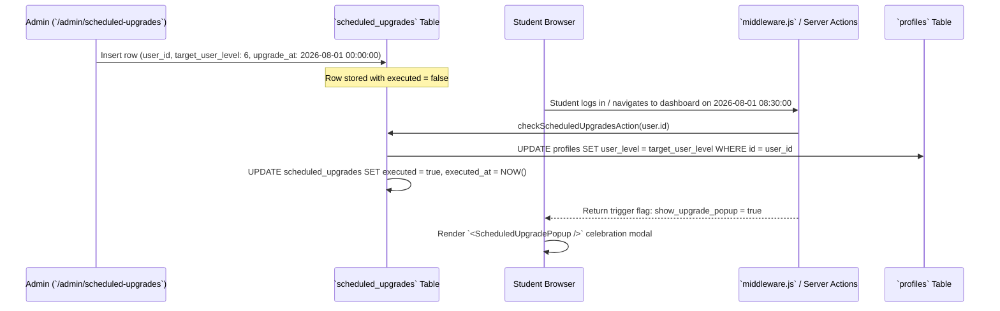

1. **Admin Staging:** An Admin enters the student's email, selects the `target_user_level` (e.g., `Level 6: Master`), and picks an exact activation timestamp (`upgrade_at`).
2. **Lazy Trigger Evaluation:** Every time a student authenticates or requests protected dashboard data (`checkScheduledUpgradesAction`), the system checks for pending records where `executed = false` AND `upgrade_at <= NOW()`.
3. **Atomic Execution:** If a matching record exists, a service-role transaction updates `profiles.user_level`, marks `executed = true`, and sets `executed_at`.
4. **Student Notification (`ScheduledUpgradePopup.jsx`):** Upon successful tier elevation, the student's dashboard immediately renders a celebratory modal informing them of their new tier privileges.

### 4.11 The Owner Control Room (`/admin/owner-control` for Level 9+ Owners)

The **Owner Control Room** (`/admin/owner-control` powered by `OwnerControlRoom.jsx` and `adminUserActions.js`) is the ultimate administrative command center, restricted strictly to users where `admin_level = 9`. It allows real-time governance over platform permissions and operational state without requiring code modifications or redeployments.

#### A) Dynamic Admin Tool Access Configurator (`admin_tool_permissions`)
Every tool card in the admin panel (`question-bank`, `module-builder`, `bulk-uploader`, etc.) checks the `admin_tool_permissions` database table before mounting. In the Owner Control Room, the Owner can dynamically modify `min_level_required` for any individual tool:
- *Example:* If an emergency bulk upload task requires Moderator assistance, the Owner can temporarily lower `bulk-uploader` from `Level 8 (Admin)` to `Level 7 (Mod)`. The instant the modification is saved, every Moderator's `AdminSidebarNav.jsx` unlocks the Bulk Uploader tab.

#### B) Site-Wide Feature Toggles & Maintenance Guard (`site_feature_toggles`)
The Owner can flip global operational switches stored in `site_feature_toggles`:
- **`maintenance_mode`:** When set to `is_enabled = true`, the `FeatureMaintenanceGuard.jsx` component intercepts all non-admin traffic across `/dashboard/*` and `/quiz/*`, rendering a full-screen maintenance banner while leaving `/admin/*` fully accessible to Level 8+ Admins.
- **`signup_enabled`:** Instantly disables new user registration via `signup/actions.js` during server migrations.
- **`desmos_calculator_enabled`:** Toggles student access to the integrated Desmos graphing calculator across all practice modules and test sections.

#### C) Administrative Hierarchy Management
The Owner Control Room displays a dedicated roster of all staff members (`admin_level >= 7`). The Owner can execute instant role transitions:
- Promote a Level 7 Moderator to Level 8 Administrator.
- Demote a Level 8 Administrator to Level 7 Moderator or revoke admin access entirely by setting `admin_level = 0`.

### 4.12 The Admin Tool Permissions System (`admin_tool_permissions`)

To replace rigid, hardcoded boolean checks across complex administrative workflows, the platform enforces database-driven authorization via the `admin_tool_permissions` table:

```sql
CREATE TABLE admin_tool_permissions (
  id UUID DEFAULT gen_random_uuid() PRIMARY KEY,
  tool_id TEXT UNIQUE NOT NULL, -- e.g., 'question-bank', 'module-builder', 'bulk-uploader'
  min_level_required INTEGER DEFAULT 8 CHECK (min_level_required BETWEEN 7 AND 9),
  description TEXT,
  updated_at TIMESTAMPTZ DEFAULT NOW()
);
```

Whenever an admin requests an internal view (`/admin/[tool]`), `RouteWrappers.jsx` invokes `checkToolPermissionAction(toolId, userAdminLevel)`. If `userAdminLevel < min_level_required`, the server action rejects access with `PERMISSION_DENIED`, and the client displays an unauthorized access lock screen.


### 4.14 Module Assignment Actions (`moduleAssignmentActions.js`)

In earlier iterations of the platform, the logic for assigning questions to modules or reordering them lived inside monolithic client event handlers. To ensure atomic bidirectional consistency between `questions.assigned_modules` and `modules.question_ids`, this logic was extracted into dedicated, transactional Server Actions within `moduleAssignmentActions.js`:

| Server Action | Payload Parameters | Transaction Behavior |
|---|---|---|
| `assignQuestionsToModuleAction` | `(moduleId, questionIdsArray)` | Uses `service_role` client to append `moduleId` to `assigned_modules` on all target `questions` and appends all `questionIdsArray` to `modules.question_ids` inside a unified batch update. |
| `removeQuestionsFromModuleAction`| `(moduleId, questionIdsArray)` | Atomically filters out `moduleId` from each question's `assigned_modules` array and removes target QIDs from `modules.question_ids`. |
| `updateModuleQuestionOrderAction`| `(moduleId, orderedQuestionIds)` | Overwrites `modules.question_ids` with the exact flattened array `orderedQuestionIds` generated by `ModuleReorderEditor` after chunk sorting. |

---

## 5. The Adjacency List File System

To present an intuitive, unified dashboard for both standalone Modules and full Practice Tests, the platform implements an **Adjacency List File System** using a dedicated `files` table.

### 5.1 Schema Structure

```sql
CREATE TABLE files (
  id UUID DEFAULT gen_random_uuid() PRIMARY KEY,
  name TEXT NOT NULL,
  type TEXT NOT NULL CHECK (type IN ('folder', 'module', 'test')),
  parent_directory TEXT NOT NULL,
  reference_id UUID NULL,
  created_at TIMESTAMPTZ DEFAULT NOW()
);
```

### 5.2 Why an Adjacency List?

Traditional file systems require deep recursive joins to traverse folder hierarchies. By storing the absolute `parent_directory` path directly on each item (e.g., `/root/math/algebra`), the dashboard achieves **O(1) fetch efficiency**.

When a user navigates to `/dashboard/modules/math/algebra`, the query is simply:
```javascript
.from('files')
.select('*')
.eq('parent_directory', '/root/modules/math/algebra')
```
This instantly returns all subfolders, modules, and tests within that directory, completely flattening the lookup complexity.

### 5.3 The `reference_id` Bridge

The `files` table acts purely as the directory structure. For files of type `module` or `test`, the `reference_id` points to the corresponding UUID in the `modules` or `practice_tests` table. The dashboard queries the `files` table first, extracts the `reference_id`s, and then batch-fetches the actual metadata (like question count, time limit, and premium status) from the respective tables.

---

## 6. The Adaptive Testing Engine

The Adaptive Testing Engine closely mirrors the structure of the official Digital SAT, offering a multi-stage adaptive routing mechanism.

### 6.1 The Schema Architecture

The `practice_tests` table defines the adaptive routing rules, while `test_submissions` tracks the precise trajectory of a student's attempt.

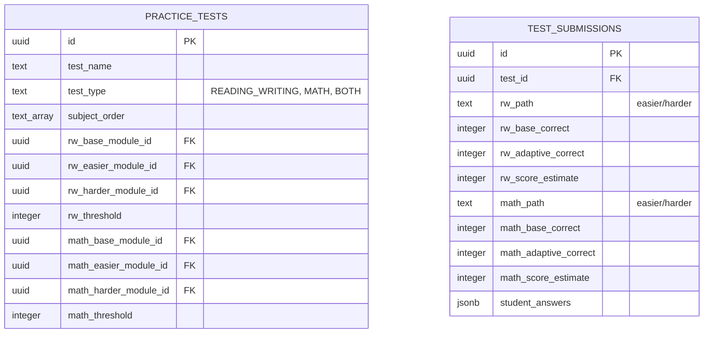

### 6.2 The Y Threshold Routing Logic & Scoring System

When a student submits the base module for a subject (e.g., Reading & Writing), the server computes their score and uses a defined threshold to route them to the appropriate next stage. 

1. **Evaluation:** `correct_answers >= threshold` (e.g., scoring at least 15/22 correct).
2. **Routing (Adaptive Branching):** If the threshold is met, the server instantly serves the `harder_module_id` payload. If it is missed, it serves the `easier_module_id` payload. This dynamic branching mimics the real Digital SAT structure perfectly.
3. **The 200-800 Scale Scoring Engine:** The final section score (combining base + adaptive module performance) is mapped to the standard SAT 200-800 scale using distinct floor and ceiling values based on the adaptive path taken:
    - **Easier Path (Penalty):** Capped ceiling. Even with a perfect score on the easier module, the section score will max out around **~590-610**. This mathematically represents that the student did not demonstrate mastery on the higher-difficulty questions.
    - **Harder Path (Reward):** High floor, maximum ceiling. A student on this path can score the full **800**, and even if they perform poorly on the harder module, they will rarely score below a **450-500** base, rewarding them for passing the initial threshold.

> [!NOTE]
> Unlike full adaptive tests, standalone **Practice Modules** (which only have one stage) use a simple linear scaling formula: `score_estimate = round((correct/total) * 800)`. This provides a rough estimate but is not dynamically weighted like the full Adaptive Testing Engine.

### 6.3 State Machine & Network Resilience

The test engine (`/test/[testId]/page.jsx`) operates as a robust state machine (`LOADING`, `INTRO`, `MODULE_ACTIVE`, `ADAPTIVE_TRANSITION`, `BREAK`, `COMPLETING`, `RESULTS`).

- **Intermediate Commits:** The state machine does not wait until the very end to hit the database. After each module, it calls `submitModuleAndRouteAction`. This protects against browser crashes by calculating grades and returning the exact data for the next phase dynamically.
- **The 10-Minute Intermission:** Between the two major subjects (Reading & Writing → Math), the engine enters the `BREAK` phase. A 600-second timer initiates, giving the student a mandatory intermission that matches real testing conditions. They can elect to skip it.
- **Client-Side Grading Fallback:** While the server authoritatively grades the modules, the final submission payload includes the aggregate metrics and raw `student_answers` JSONB to guarantee scoring fidelity.

### 6.4 The Admin Test Builder

Admins construct these sophisticated adaptive tests via the Test Builder UI. 

**Core Concept:** A "Test" in this architecture does not contain any questions directly. Instead, a Test is purely a **routing wrapper** that links together existing standalone Modules. To build a full SAT test, an admin must first create the 6 individual modules (RW Base, RW Easier, RW Harder, Math Base, Math Easier, Math Harder) in the Module Builder, and then link them together in the Test Builder.

The interface allows admins to:
- **Configure Test Scope:** Select whether the test covers Both Subjects (full length), Math only, or R&W only.
- **Link Modules:** Use dropdowns to assign pre-built modules to the Base, Easier, and Harder slots for each subject.
- **Set Thresholds:** Define the exact integer threshold (e.g., `15`) required to branch a student from the Base module to the Harder module. If the student scores below this threshold, the routing engine serves the Easier module.
- **Publish:** The test is immediately injected into the virtual file system (Adjacency List) for dashboard access.

### 6.5 The Desmos Graphing Calculator Integration (`DesmosCalculator.jsx`)

To precisely replicate the official College Board Digital SAT testing experience, the platform integrates the full **Desmos Graphing Calculator API** directly into both the Practice Engine (`/quiz/[moduleId]`) and the Adaptive Test Engine (`/test/[testId]`).

- **Interactive Iframe/API Wrapper (`DesmosCalculator.jsx`):** Employs the official Desmos Calculator JavaScript bundle (`https://www.desmos.com/api/v1.8/calculator.js`), instantiating a fully responsive, draggable, and resizable floating window (`DesmosCalculator.jsx`) directly above the question container.
- **Toggle Control & Feature Gate:** Students open or dismiss the calculator via the top navigation bar icon ("Calculator"). The visibility of this button is controlled server-side via `site_feature_toggles.desmos_calculator_enabled`, allowing administrators to instantly disable Desmos during specific diagnostic exams or non-calculator math modules without redeploying frontend assets.
- **State Persistence Across Questions:** As the student navigates between questions within a module or adaptive section, the Desmos calculator instance preserves all typed equations, variables, and graph zoom coordinates in memory, ensuring seamless calculation continuity throughout the timed section.

### 6.6 The Test Demo System (`/test-demo/[testId]`) for Guest Practice

To lower the barrier to entry and boost student acquisition, the platform implements a specialized **Test Demo Engine** (`/test-demo/[testId]/page.jsx`), allowing unauthenticated guest users (`user_level = 0`) to sample adaptive testing mechanics before registering an account.

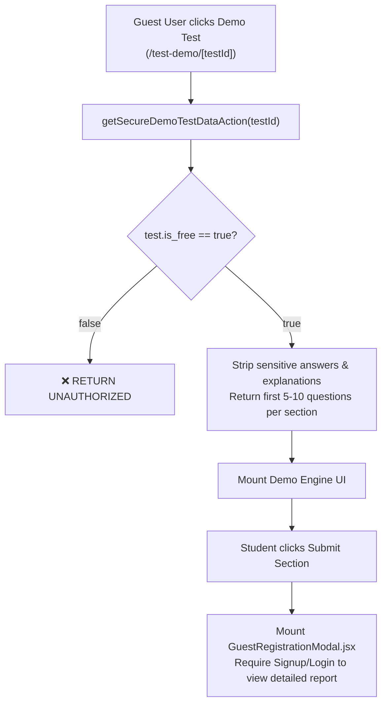

- **Sanitized Data Delivery (`getSecureDemoTestDataAction`):** Server Actions verify that `practice_tests.is_free = true`. To prevent scraping of proprietary question banks, the demo action strips all `correct_answer` and `correct_answer_explanation` fields before transmitting the payload to the browser.
- **Conversion Gate (`GuestRegistrationModal.jsx`):** When the guest finishes the base module or attempts to view their adaptive score estimate, the engine intercepts the completion trigger and displays `GuestRegistrationModal.jsx`, preserving their session progress while prompting immediate account registration via `/signup`.

### 6.7 Practice Mode vs Test Mode Execution Architecture

The platform separates client-side quiz execution into specialized, modular engines depending on whether the student is completing a standalone study module, a randomized session, or a high-stakes adaptive test:

| Architectural Feature | Static Practice Mode (`PracticeEngine.jsx`) | Randomized Practice (`PracticeEngine.jsx`) | Adaptive Test Mode (`TestEngine.jsx`) |
|---|---|---|---|
| **Route Scope** | Mounted on `/quiz/[moduleId]` | Mounted on `/practice/[sessionId]` | Mounted on `/test/[testId]` |
| **Section Structure** | Single static question list (`modules.question_ids`) with no adaptive branching between sections. | Dynamic list generated from `localStorage` based on filters (subject, topic, difficulty). | Multi-stage adaptive trajectory (`rw_base` → `rw_adaptive` → `INTERMISSION` → `math_base` → `math_adaptive`). |
| **Timer Enforcement**| Soft timer (`time_limit_minutes`). When time expires, student receives a warning toast (`Time's Up!`) but can elect to continue working in overtime mode. | Per-question soft timer (1 minute per question limit x total questions). Prompts user upon expiration. | Hard authoritative timer (`TestTimer.jsx`). When time expires, the active section auto-submits instantaneously via `submitModuleAndRouteAction` and locks the interface. |
| **Explanation Access**| Students can toggle immediate answer checks and view `correct_answer_explanation` after answering each question (if enabled by tier). | Immediate answer checks available. Upon completion, enters read-only "Review Mode" on the same session URL. | Strict exam security: explanations and correct answers are hidden until the entire multi-section test completes and `results` are committed to `test_submissions`. |
| **Submission Action** | Calls `submitQuizAction(submissionData)` → inserts row into `submissions` table (subject to daily rate limits). | Fully stateless. Consumes quota upfront; no database insertion on submission. | Calls `submitModuleAndRouteAction(testId, stageData)` → performs Y-threshold branching and updates `test_submissions`. |
| **Admin QA Overrides**| Admins (`admin_level ≥ 7`) can use `AdminViewLevelSwitcher.jsx` to instantly emulate free or guest user tiers. | Emulation switcher applies. Admins can verify daily quota triggers and limits dynamically. | Admins (`admin_level ≥ 7`) get exclusive **`Force Easy Mode`** and **`Force Hard Mode`** override buttons on the test intermission screen. |

#### 6.7.1 Admin QA Tools in Testing: Path Forcing & Tier Emulation (`TestEngine.jsx` & `AdminViewLevelSwitcher.jsx`)

To allow staff and moderators (`admin_level ≥ 7`) to rapidly debug question assets and verify adaptive routing logic without spending 35 minutes answering every question correctly or incorrectly during Module 1, the test engine and dashboard layout inject two specialized QA controls directly into the UI:

1. **Adaptive Path Forcing Buttons (`forceMode` on `/test/[testId]`):**
   When an admin or moderator initiates a full-length practice test (`TestEngine.jsx`), the pre-test intermission start screen renders three exclusive override buttons:
   - **`Normal Adaptive` (`forceMode = 'default'`):** Standard student evaluation based on `rw_threshold` / `math_threshold`.
   - **`Force Easy Mode` (`forceMode = 'easier'`):** Bypasses threshold evaluation completely and forces the engine to route directly to `rw_easier_module_id` or `math_easier_module_id` for Module 2.
   - **`Force Hard Mode` (`forceMode = 'harder'`):** Bypasses threshold evaluation completely and forces the engine to route directly to `rw_harder_module_id` or `math_harder_module_id` for Module 2.
   This guarantees that QA engineers can immediately inspect and debug specific hard or easy module question banks (`_SANDBOX_` or production items) on demand.

2. **Top-Right / Floating Tier Switcher (`AdminViewLevelSwitcher.jsx` & `getUserLevel.js`):**
   Rendered across all dashboard layouts (`/dashboard/*`, `/class/[id]`, and testing routes) whenever `admin_level ≥ 7`, this floating interface button allows admins to instantly switch their emulated user tier:
   - Admins can select **`Emulate Level 1 (Free)`** or **`Emulate Level 0 (Guest)`**.
   - The selected override is saved into session cookies (`admin_view_as_level` / `emulated_user_level`) via `setAdminViewLevelAction`.
   - The central tier resolver `getEffectiveUserLevel()` intercepts this cookie and forces all server guards (`getSecureQuizDataAction`, `checkScheduledUpgradesAction`, `DashboardSidebarNav.jsx`) to lock or unlock precisely as if the admin were a real student of that tier, allowing seamless end-to-end QA verification of upgrade prompts and paywalls.

#### 6.7.2 Randomized Practice Engine (`/practice/[sessionId]`)

In addition to static modules and adaptive tests, the platform features a highly dynamic **Randomized Practice Engine**.

- **Session Initialization:** Initiated from the Practice Dashboard (`/dashboard/practice/PracticeClient.jsx`). The client filters the global question pool by subject, difficulty range, source, and topic. Selected question IDs (qids) are sent to `fetchPracticeQuestionsAction`.
- **Quota Check & Pre-fetching:** The server-action enforces the daily quota limits (`practice_config`), irreversibly deducts the requested question count from the user's `today_submitted` profile counter, and fetches the full question payloads.
- **Stateless Client Routing:** Unlike tests which have server-managed states, the Randomized Practice Engine is stateless on the server during execution. The fetched question array is serialized into browser `localStorage` under a unique `sessionId`. The user is immediately redirected to `/practice/[sessionId]`, which hydrates the Practice Engine purely from `localStorage`.
- **Review Mode Re-entry:** Upon completion, the student can toggle back into "Review Mode" on the same session URL. The engine reads the saved state (which includes their submitted answers and correct explanations) and renders the quiz UI in a read-only review state without requiring any additional database reads.

### 6.8 Student Report Bug Modal & Floating Trigger (`ReportBugModal.jsx`)

During both Practice Mode (`PracticeEngine.jsx`) and Test Mode (`TestEngine.jsx`), every question viewport renders a subtle, floating exclamation icon (`FloatingBugReportButton.jsx`) anchored to the top-right of the stimulus/passage box.

- **Zero-Disruption Modal Overlay:** Clicking the trigger pauses any active soft study timers and opens `ReportBugModal.jsx` in an overlay without refreshing the page or clearing selected answer states (`student_answers`).
- **Auto-Attached Question Context:** The modal automatically binds the current question's unique identifier (`qid`), option hash, and parent module ID to the submission payload before invoking `submitBugReportAction()`, guaranteeing admins can immediately locate and fix reported issues.

### 6.9 Scoring & Access Utilities (`dsatScoring.js` & `getUserLevel.js`)

The core mathematical scaling curves and access calculations are centralized within discrete backend utility modules to ensure exact parity across all server actions:

#### A) Digital SAT Scoring Engine (`utils/dsatScoring.js`)
Instead of linear percentages, `dsatScoring.js` implements a proprietary **Difficulty-Weighted Curve Engine**:
- **Base Module Evaluation:** Calculates raw correct counts for `rw_base` (out of 22) or `math_base` (out of 22).
- **Adaptive Curve Matrix:** Applies distinct lookup tables depending on whether the student branched into `easier` or `harder` adaptive paths:
```javascript
export function calculateSectionScore(subject, basePath, totalCorrect) {
  if (basePath === 'harder') {
    // Harder path: High floor (480+), ceiling reaches 800
    return Math.min(800, Math.max(480, 480 + Math.round((totalCorrect - 15) * 32)));
  } else {
    // Easier path: Floor starts at 200, capped ceiling around 590
    return Math.min(590, Math.max(200, 200 + Math.round(totalCorrect * 18)));
  }
}
```
This ensures composite practice test scores accurately reflect College Board scaling standards.

#### B) Centralized Access Resolver (`utils/getUserLevel.js`)
The `getUserLevel.js` utility exports standardized tier resolution functions (`getUserLevel`, `getEffectiveUserLevel`, and `hasMinUserLevel`) used across API routes and components:
- **Fallback Hierarchy:** If `profiles.user_level` is `NULL` or unpopulated on legacy accounts, `getUserLevel(profile)` checks `is_admin` (`admin_level = 8`), then checks `is_premium` (`user_level = 6`), falling back safely to `user_level = 1` (`Free Account`).
- **Emulation Cookie Injection:** When processing SSR headers in `middleware.js` or Server Components, `getEffectiveUserLevel` inspects request cookies for `emulated_user_level` whenever `admin_level >= 7`, overriding the database return value for testing fidelity.

### 6.10 Test Review Engine (`/test-review/[subId]`)

After completing a full adaptive practice test, students are routed to a specialized **Test Review Engine** to analyze their performance question-by-question.

- **Dual-DB Hydration:** The server component (`page.jsx`) fetches the core `test_submissions` record from the User DB, then cross-references the four module IDs (`rw_base_module_id`, `rw_adaptive_module_id`, etc.) to fetch `modules`, `practice_tests`, and `questions` metadata from the Content DB.
- **Lazy-Loaded Question Data:** To keep initial page load fast for 90+ question tests, the `ReviewEngine.jsx` client component lazily fetches full question details (KaTeX strings, images, option hashes) via the `getQuestionByIdAction(qid)` server action only as the student navigates to each question.
- **KaTeX Explanation UI:** The engine renders a detailed `correct_answer_explanation` box alongside the student's selected answer and the correct answer, utilizing the standard `RichText` pipeline.

---

## 7. The Student Portal & Testing Environment

### 7.1 Dashboard Architecture

The student dashboard is a **Server Component** layout (`dashboard/layout.jsx`) wrapping two pages:

| Route | Component Type | Data Source | Purpose |
|---|---|---|---|
| `/dashboard` | Server Component | `profiles` (User DB) | Personalized hub page with upgrade/signup cards |
| `/dashboard/modules/[[...path]]` | Client Component | `files` & `modules` (Content DB) | Dedicated adjacency list module explorer (`ModulesExplorerClient.jsx`) |
| `/dashboard/practice-tests/[[...path]]` | Client Component | `files` & `practice_tests` (Content DB)| Dedicated practice test explorer (`PracticeTestsExplorerClient.jsx`) |
| `/dashboard/practice` | Client Component | `questions` (Content DB) | Randomized Practice Engine dashboard with subject, topic, and difficulty filters |
| `/dashboard/history` | Server Component | `submissions` & `test_submissions` | Unified timeline of past module and full test submissions |
| `/dashboard/history/[subId]` | Server Component | Single submission + questions | Detailed answer review for standalone modules |

> [!NOTE]
> The `HistoryGuestClient.jsx` component provides a graceful fallback UI for the `/dashboard/history` route when accessed by unauthenticated guests (`user_level = 0`), prompting them to register.

The layout performs **live premium status checks** on every render:
```javascript
export const revalidate = 0  // Disable Next.js caching
```
This ensures the premium badge and module access locks always reflect the current database state, not a stale cache.

**Module Cards:** Each module card computes access dynamically:
```javascript
const hasAccess = module.is_free || isPremium;
```
Locked modules get a `backdrop-blur` overlay with a "Premium Required" badge. Even if a student somehow navigated to `/quiz/{lockedModuleId}`, the server-side `getSecureQuizDataAction()` would reject them.

### 7.2 The Quiz Engine — React State Architecture

The quiz page (`quiz/[moduleId]/page.jsx`) is the most complex client component in the system at ~860 lines. It manages **14 independent state variables**:

| State Variable | Type | Purpose |
|---|---|---|
| `moduleData` | Object | Module metadata (name, time limit) |
| `questions` | Array | Ordered question objects from server |
| `currentIndex` | Number | Active question position (0-indexed) |
| `answers` | Object `{qid: value}` | Student's selected answers |
| `markedForReview` | Object `{qid: bool}` | Bookmark flags per question |
| `eliminatedOptions` | Object `{qid: {letter: bool}}` | Crossed-out options per question |
| `timeRemaining` | Number (seconds) | Countdown timer state |
| `isTimerVisible` | Boolean | Timer show/hide toggle |
| `showQuestionMenu` | Boolean | Navigation modal visibility |
| `showExitModal` | Boolean | Submit confirmation modal |
| `showTimeUpModal` | Boolean | Time expired modal |
| `highlights` | Object `{qid: [{startOffset, endOffset, color, containerIndex}]}` | CSS Custom Highlight API data |
| `leftWidth` | Number (percent) | Resizable divider position |
| `showEliminators` | Boolean | Option elimination mode toggle |

### 7.3 The Timer System

The timer initializes from `moduleData.time_limit_minutes * 60` (converted to seconds) and decrements every 1000ms via `setInterval`. Key behaviors:

| Condition | Behavior |
|---|---|
| Timer reaches 0 | `showTimeUpModal = true`, interval cleared |
| `showTimeUpModal` is true | Timer paused (interval dependency) |
| `showExitModal` is true | Timer paused (interval dependency) |
| Timer < 5 minutes | Display turns red (`text-red-400`) |
| Timer hidden | Shows "Hidden" with clock icon |

> [!IMPORTANT]
> The timer **pauses** when the exit modal is open. This is implemented via the `useEffect` dependency array: `[timeRemaining, showTimeUpModal, showExitModal]`. When either modal is `true`, the effect's condition `!showTimeUpModal && !showExitModal` fails, preventing `setInterval` from starting.

### 7.4 The CSS Custom Highlight API

The quiz engine implements **per-question text highlighting** using the browser's native CSS Custom Highlight API — not DOM manipulation or `<span>` injection:

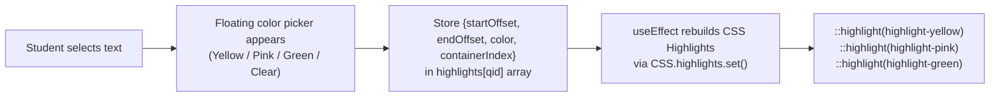

**Why the Custom Highlight API instead of `<mark>` tags?** Three reasons:
1. **Non-destructive.** It doesn't modify the DOM, so it can't break ReactMarkdown's rendered output or KaTeX math formulas.
2. **Persistent across re-renders.** Highlights are stored as abstract offset ranges, not DOM references. When React re-renders the component, the `useEffect` reapplies them.
3. **Per-question isolation.** Each question's highlights are stored under its QID key. Navigating between questions shows/hides the correct highlights.

The `containerIndex` field tracks WHICH `.highlightable-area` div the highlight belongs to (0 = context pane, 1 = question pane), enabling highlights across the resizable split view.

### 7.5 Option Elimination System

The elimination system uses a nested state object:
```javascript
eliminatedOptions = {
  "qid_001": { "A": true, "C": true },  // A and C are crossed out
  "qid_002": { "B": true }               // Only B is crossed out
}
```

Eliminated options receive visual treatment: `opacity-40 grayscale` + a red strikethrough line, and their click handler is disabled (`disabled={isEliminated}`). If a student had previously selected an eliminated option, the selection persists but cannot be re-clicked until restored.

### 7.6 SPR (Student-Produced Response) Grading

For SPR questions, the grading engine supports **multiple valid answers** and **mathematical equivalence**:

```javascript
const checkMultipleSprs = (studentInput, dbAnswerString) => {
  const possibleAnswers = String(dbAnswerString).split('||');
  return possibleAnswers.some(ans => gradeSpr(studentInput, ans));
};
```

The `gradeSpr()` function checks:
1. **Exact string match** (e.g., `"3.5"` === `"3.5"`)
2. **Fraction equivalence** (e.g., `"7/2"` → `3.5` === `3.5`)
3. **Floating-point tolerance** (`Math.abs(student - correct) < 0.001` for positive, `< 0.01` for negative)

The `||` delimiter in `correct_answer` separates multiple valid forms: `"3.5 || 7/2 || 3.50"`.

### 7.7 The Submission & Review Flow

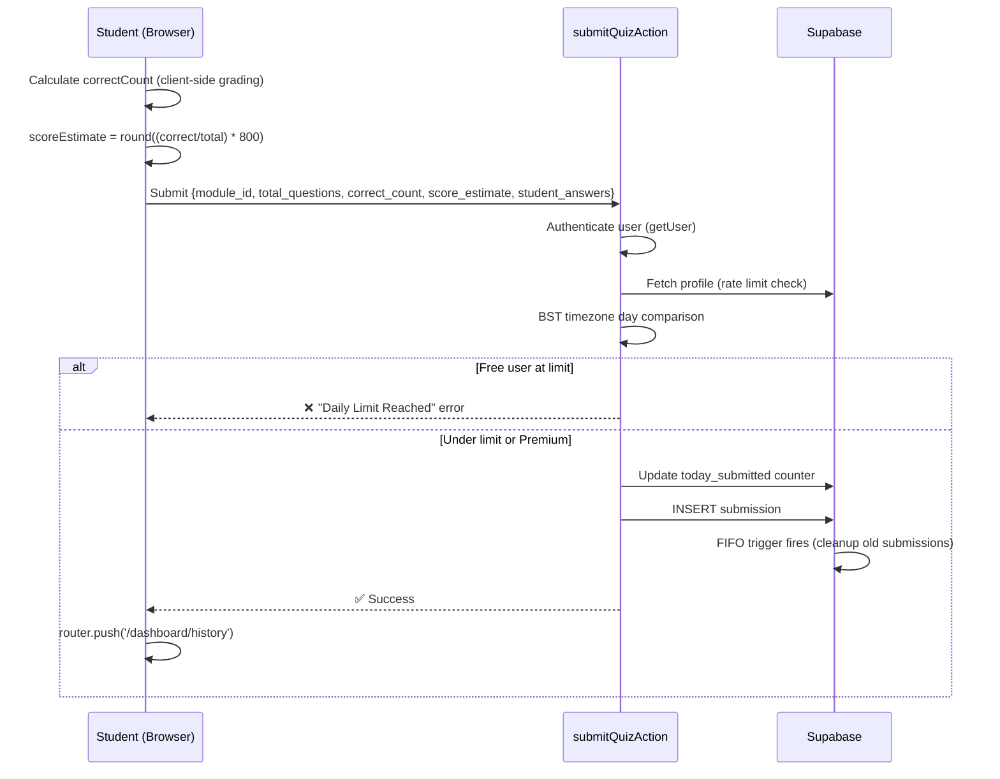

> [!WARNING]
> Grading happens **client-side** before submission. The `student_answers` JSONB (a map of QID → answer letter/text) is stored alongside the computed score. This means the score could theoretically be spoofed by modifying the `score_estimate` field. However, since the raw `student_answers` are preserved, the correct score can always be recomputed server-side if needed.

The **Submission Review Page** (`/dashboard/history/[subId]`) fetches the submission's `student_answers` JSONB and cross-references each answer against the actual question data, displaying correct/incorrect badges, the student's answer, the correct answer, and the full explanation.

### 7.8 Sidebar Active Navigation State (`DashboardSidebarNav.jsx` & `AdminSidebarNav.jsx`)

To ensure intuitive spatial orientation across multiple nested dashboard routes, both the student dashboard and admin panel feature dedicated client-side navigation sidebars (`DashboardSidebarNav.jsx` and `AdminSidebarNav.jsx`) that leverage Next.js `usePathname` hooks:

- **Exact & Prefix Match Highlighting:** The sidebar checks `pathname === item.href` for exact matches (like `/dashboard` root) or `pathname.startsWith(item.href + '/')` for sub-routes (`/dashboard/practice` or `/dashboard/history/123`), dynamically applying active background styling (`bg-slate-800 text-cyan-400 font-semibold border-l-4 border-cyan-400`).
- **Collapsible Mobile & Desktop Drawer:** Responsive slide-over menu architecture controlled via local state toggles (`isOpen`), allowing zero-clutter reading during practice sessions while keeping full route trees accessible within a single click.

### 7.9 The Tier Upgrade Page (`/upgrade/page.jsx` & `UpgradeClient.jsx`)

When students click "Upgrade Plan" or hit a rate limit / premium lock screen, they are routed to `/upgrade` (`UpgradeClient.jsx`), which displays an interactive feature comparison matrix across all four subscription tiers:

| Plan Tier | Level Range | Target Audience | Key Feature Unlocks |
|---|---|---|---|
| **Free** | `Level 1` | Standard registered students | 5 daily module submissions, basic study modules, 2-submission FIFO history |
| **Practice**| `Level 2-3` | Dedicated daily practice | Unlimited daily module submissions, full practice module catalog (`/dashboard/practice`) |
| **Flash** | `Level 4-5` | Intensive exam preparation | Full adaptive practice tests (`/test/[testId]`), live lecture streaming (`/dashboard/classes`) |
| **Master** | `Level 6-7` | Complete VIP mastery | All modules & tests, scheduled upgrades, priority bug resolution, 100-submission FIFO tracking |

- **Direct WhatsApp / Checkout Action:** Each plan card triggers direct contact initiation or secure checkout linking with pre-populated student ID metadata, streamlining administrative upgrade processing.

### 7.10 Student Profile Management (`/dashboard/profile/page.jsx` & `ProfileClient.jsx`)

Students can self-manage their academic profile via `/dashboard/profile` (`ProfileClient.jsx`). The profile interface allows real-time modifications to personal metadata stored in the `profiles` table:
- **Editable Attributes:** `full_name`, `whatsapp_number`, `institution`, and `academic_year`.
- **Server Action Updates (`updateProfileMetadataAction`):** Profile changes bypass client-side REST calls and execute directly via authenticated server actions, ensuring input sanitization and RLS enforcement.
- **Plan & Expiration Status Display:** Surfaces the student's active tier name (`user_level`), numeric badge, and exact timestamp when their current premium subscription expires (`premium_expires_at`).

### 7.11 Server Actions & Zero-REST API Architecture

A defining hallmark of the platform is its almost total elimination of traditional client-side `fetch()` API calls (`/api/*`) for database mutations. Instead, **99% of data operations occur via Next.js Server Actions** using the `service_role` Supabase client:

- **Security Isolation:** Because mutations (`submitQuizAction`, `assignQuestionsToModuleAction`, `processBulkUploadAction`) run entirely server-side inside Node.js execution contexts, sensitive business rules—such as rate limit calculations, duplicate hash verification, and user level upgrades—cannot be bypassed by inspecting network tabs or manipulating browser console payloads.
- **Webhooks & External Integrations (`/api/*`):** The isolated `/api/` route tree is reserved strictly for third-party server-to-server webhooks (such as Stripe/payment gateway notifications or automated build pipelines), ensuring complete architectural separation between student browser interactions and automated infrastructure triggers.

---

## 8. The Text Rendering Pipeline

> A complete technical deep-dive into how text flows from external data ingestion all the way to the student's screen.

### 8.1 Architecture Overview

Text flows through **two completely separate stages** at different points in time:

```text
┌──────────────────────────────────────────────────────────────────┐
│                     STAGE 1: UPLOAD TIME                        │
│                                                                  │
│  Admin uploads JSON  ──→  Client-side validation & transforms   │
│                       ──→  Server-side processBulkUploadAction  │
│                       ──→  Stored in Supabase 'questions' table │
└──────────────────────────────────────────────────────────────────┘
                               │
                               │  (Raw Markdown strings sit in DB)
                               ▼
┌──────────────────────────────────────────────────────────────────┐
│                     STAGE 2: RENDER TIME                        │
│                                                                  │
│  Student opens quiz  ──→  Server fetches raw text from DB       │
│                      ──→  RichText component receives string    │
│                      ──→  fixBrokenMarkdownTables() sanitizes   │
│                      ──→  ReactMarkdown parses to HTML          │
│                      ──→  KaTeX renders math, GFM renders tables│
│                      ──→  Student sees formatted content        │
└──────────────────────────────────────────────────────────────────┘
```

> [!IMPORTANT]
> Stage 1 transforms are **destructive** (they permanently modify data before storage). Stage 2 transforms are **non-destructive** (they only affect display, the raw string in the DB is never touched).

---

### 8.2 Stage 1: Bulk Uploader — Text Transformations

#### JSON Sanitization (Backslash Escaping)

Fixes invalid JSON caused by unescaped backslashes from raw data providers. Many LaTeX formulas contain single backslashes (like `\frac`) which are invalid in JSON strings.

```javascript
const sanitizedText = rawText.replace(/(?<!\\)\\(?!["\\/bfnrt])/g, '\\\\');
```

This uses a negative lookbehind and negative lookahead to find lone backslashes that aren't already escaped or part of a valid sequence, and doubles them. Without this, `JSON.parse()` throws a `SyntaxError` on LaTeX math.

#### QID Reformatting (Underscore Insertion)

Automatically inserts an underscore `_` before the trailing `qNNNN` suffix to enforce a consistent database schema.

```javascript
const qidRegex = /(.*?[^_])(q\d+)$/i;
newQid = newQid.replace(qidRegex, '$1_$2');
```

#### Hash Fingerprinting

Generates a SHA-256 hash of each question's content to detect duplicates across uploads.

**MCQ Hash Formula (Standard):**
```text
SHA-256( sorted_options_joined_by_pipe | correct_answer_text )
```

**SPR Hash Formula:**
```text
SHA-256( context | question )
```

> [!IMPORTANT]
> Sorting options means that if two questions have the same choices in different order, they produce the **same hash** and are flagged as duplicates. This catches reworded copies.

---

### 8.3 Stage 2: RichText Renderer — Display Pipeline

These transformations happen inside `components/RichText.jsx` every time a question is rendered.

#### stripOptionLetter()

Strips leading option letters (A, B, C, D) from option text, since the UI displays its own letter badges.
```javascript
text.replace(/^[A-D][.)]?\s+/, '');
```

#### fixBrokenMarkdownTables() — The 6-Step Sanitizer

This function executes 6 sequential regex transformations to fix common Markdown anomalies:

| Step | Regex Target | Fix |
|---|---|---|
| 0 | Literal `\n` strings | Convert to real newlines (with LaTeX command protection via negative lookahead for `\nabla`, `\neq`, etc.) |
| 0.25 | `\dollar` macro | Replace with `\char36` inside math blocks, `\$` outside |
| 0.3 | `\underline{text}` macro | Convert to HTML `<u>` tag with custom styling |
| 0.4 | Squished `\text{}` blocks | Add leading/trailing spaces inside `\text{}` for proper KaTeX spacing |
| 0.5 | `\^{\circ}` | Fix double-escaped degree symbols |
| 0.6 | `\indent` macro | Wrap paragraph in `<div class="pl-[5%]">` for block indentation (supports `\\+indent` — any number of backslashes) |
| 1 | `\|\|` in table context | Split concatenated table rows |
| 2 | Plain text before tables | Auto-generate `#####` captions |
| 3 | Table-to-text boundary | Force paragraph break after table end |
| 4 | Single newlines | Convert to Markdown hard breaks (two trailing spaces) |

#### ReactMarkdown + Plugins

After sanitization, the string passes to `ReactMarkdown` with three plugins:

| Plugin | Syntax Handled | Rendered Output |
|---|---|---|
| `remark-gfm` | `\| A \| B \|`, `~~strike~~` | HTML `<table>`, strikethrough |
| `remark-math` | `$x^2$`, `$$\frac{a}{b}$$` | Marks text as math nodes |
| `rehype-katex`| Math nodes | Converts to KaTeX HTML |
| `rehype-raw` | Raw HTML tags | Enables `<div>`, `<u>` from custom macros |

#### The `||` Appended Image System

The `RichTextBase` component handles appended images (used in options and explanations):
1. **Split** the string by ` || ` delimiter
2. **Render Text:** First element passes through ReactMarkdown
3. **Render Images:** Subsequent elements are rendered as `` tags sequentially below the text

This supports multiple images per field (e.g., `"explanation text || img_a.jpg || img_b.jpg"`).

#### Custom Component Overrides

ReactMarkdown outputs generic HTML elements. The `markdownComponents` object intercepts specific elements and replaces them with custom styles (e.g., collapsing table borders, applying dark backgrounds to `<th>`, and mapping `<h5>` to centered table captions).

> [!IMPORTANT]
> **Key Takeaway:** The database stores **raw Markdown** — never pre-rendered HTML. All visual formatting happens at render time through the `RichText` component. If a bug in the renderer is fixed, ALL existing questions benefit immediately.

---

## 9. Comprehensive File Directory

### Core Configuration

| File | Purpose |
|---|---|
| `package.json` | Next.js 16, React 18, Supabase SSR, KaTeX, ReactMarkdown, remark-gfm, remark-math, rehype-katex, rehype-raw, sharp, Lucide icons |
| `next.config.js` | 50MB server action body limit (both `experimental` and top-level), Supabase image domain whitelist |
| `middleware.js` | Three-tier auth gate (public → authenticated → admin) |
| `tailwind.config.js` | Tailwind CSS configuration |
| `jsconfig.json` | Path alias: `@/` → project root |

---

### Supabase Clients

| File | Client Type | Key Used | Purpose |
|---|---|---|---|
| `utils/supabase/server.js` | Server (SSR) | `ANON_KEY` | Cookie-based auth for Server Components |
| `utils/supabase/client.js` | Browser | `ANON_KEY` | Client-side Supabase for `RouteWrappers` |

---

### Server Actions (`app/actions/`)

| File | Exports | Auth Model | Purpose |
|---|---|---|---|
| `bulkActions.js` | `processBulkUploadAction`, `checkExistingQidsAction`, `checkDuplicatesAction`, `deleteQuestionAction` | Service Role (bypasses RLS) | Production JSON/image upload pipeline and question management |
| `quizActions.js` | `getSecureQuizDataAction`, `submitQuizAction`, `getSecureDemoTestDataAction` | Dual: User auth check + Service Role for data access | Validates tier access (`user_level`), fetches sanitized questions, and logs submissions |
| `practiceActions.js` | `getPracticeDashboardMetadataAction`, `fetchPracticeQuestionsAction`, `getPracticeConfigAction`, `updatePracticeConfigAction` | Dual: User auth + Service Role | Randomized Practice Engine data fetching, daily quota enforcement, and admin config management |
| `adminUserActions.js` | `forceChangePassword`, `getLightweightUsers`, `getUserDetails`, `getUserActivity`, `updateUserPlan` | Service Role (`admin_level >= 8`) | User administration, tier changes, and staff promotions |
| `bugActions.js` | `submitBugReportAction`, `getBugReportsAction`, `batchUpdateBugStatusAction`, `batchDeleteBugsAction` | User Auth (submission) / Service Role (`admin_level >= 7` for triage) | Student bug report capture and Kanban triage management |
| `telemetryActions.js` | `recordTelemetryEventsAction`, `getAnalyticsDashboardDataAction` | Service Role (async batch insertion & metrics aggregation) | Non-blocking telemetry tracking and analytics data aggregation |
| `rehashActions.js` | `scanDatabaseHashesAction`, `resolveHashCollisionAction`, `healRestructuredHashesAction` | Service Role (`admin_level >= 8`) | SHA-256 hash integrity scanning and collision resolution |

| `moduleAssignmentActions.js` | `assignQuestionsToModuleAction`, `removeQuestionsFromModuleAction`, `updateModuleQuestionOrderAction` | Service Role (`admin_level >= 8`) | Atomic bidirectional synchronization between questions and modules |
| `adminScheduledUpgradeActions.js`| `scheduleUserUpgradeAction`, `checkScheduledUpgradesAction`, `getScheduledUpgradesAction`| Service Role (Lazy evaluation during login/dashboard mount) | Automated delayed tier promotions (`user_level`) and celebration modals |
| `testActions.js` | `getTestInfoAction`, `startTestAction`, `submitModuleAndRouteAction`, `getQuestionByIdAction` | Dual: User auth + Service Role | Core state machine for adaptive testing, threshold routing, and lazy-loaded question fetching |
| `difficultyEngineActions.js` | `recordItemAttemptO1Action`, `recordBatchAttemptsO1Action` | Service Role (cross-db) | O(1) expected difficulty rating engine; computes proficiency-weighted Elo scale for items |
| `classesActions.js` | `createClassAction`, `updateClassStatusAction`, `attachClassRecordingAction`, `getStudentClassesAction` | Service Role (`admin_level >= 8` for mutations / tiered student checks) | Live lecture scheduling (`meeting_url`) and video recording (`recordings`) access |

---

### Auth Pages

| File | Type | Purpose |
|---|---|---|
| `app/login/page.jsx` | Server Component | Login form with error display |
| `app/login/actions.js` | Server Action | `login()` via `signInWithPassword`, `logout()` via `signOut` |
| `app/signup/page.jsx` | Server Component | Registration form (5 metadata fields) |
| `app/signup/actions.js` | Server Action | `signup()` via `signUp` with `raw_user_meta_data` |
| `app/terms/page.jsx` | Server Component | Static Terms of Service, Privacy Policy, and Anti-Scraping terms |
| `app/not-found.jsx` | Server Component | Custom 404 error page with glowing background effects |

---

### Student Portal (`app/dashboard/`)

| File | Type | Purpose |
|---|---|---|
| `dashboard/layout.jsx` | Server Component | Main student wrapper with `DashboardSidebarNav.jsx`, profile avatar, live premium check, and maintenance gating |
| `dashboard/page.jsx` | Server Component | Personalized hub page with upgrade/signup cards |
| `dashboard/modules/[[...path]]` | Client Component | Dedicated adjacency list module explorer (`ModulesExplorerClient.jsx`) |
| `dashboard/practice-tests/[[...path]]`| Client Component | Dedicated practice test explorer (`PracticeTestsExplorerClient.jsx`) |
| `dashboard/practice/page.jsx` | Server/Client Route | Randomized Practice Engine dashboard (`PracticeClient.jsx`) with topic/difficulty filters |
| `dashboard/classes/page.jsx` | Server Component | Live schedule and recorded video library (`ClassStreamerClient.jsx`) gated by `required_user_level` |
| `dashboard/history/page.jsx` | Server Component | Unified timeline of past module and full test submissions |
| `dashboard/history/[subId]/page.jsx` | Server Component | Per-question answer review for standalone modules |
| `dashboard/profile/page.jsx` | Server Component | Student profile management (`ProfileClient.jsx`), WhatsApp editing, and plan expiration view |
| `app/upgrade/page.jsx` | Server Component | Premium upgrade portal containing `PromoPopup.jsx` logic for Level 1 users |
| `components/DashboardSidebarNav.jsx`| Client Component | Active route highlighting (`usePathname`) and responsive slide-over navigation drawer |
| `components/ScheduledUpgradePopup.jsx`| Client Component | Celebratory modal triggered on login when `checkScheduledUpgradesAction` executes a tier promotion |
| `components/FeatureMaintenanceGuard.jsx`| Client Component | Intercepts dashboard/quiz traffic during global maintenance (`site_feature_toggles.maintenance_mode`) |
| `dashboard/history/HistoryGuestClient.jsx`| Client Component | Graceful fallback UI for unauthenticated users accessing `/dashboard/history` |

---

### Quiz & Test Engines

| File | Type | Lines | Purpose |
|---|---|---|---|
| `app/quiz/[moduleId]/page.jsx` | Client Component | ~862 | Static module practice environment (`PracticeEngine.jsx`): soft timer, custom highlight API, option elimination, navigation |
| `app/practice/[sessionId]/page.jsx` | Client Component | ~900 | Randomized Practice environment (`PracticeEngine.jsx`): hydrated purely from localStorage, stateless server execution, and Review Mode |
| `app/test/[testId]/page.jsx` | Client Component | ~800 | Full adaptive test engine (`TestEngine.jsx`): Y-threshold routing, authoritative `TestTimer.jsx`, intermission state machine |
| `app/test-demo/[testId]/page.jsx` | Client Component | ~620 | Guest demo test engine (`user_level = 0`) with sanitized payloads and `GuestRegistrationModal.jsx` conversion trigger |
| `app/test-review/[subId]/page.jsx` | Server/Client Route | ~500 | Digital SAT-style question review engine (`ReviewEngine.jsx`) with lazy-loaded data via `getQuestionByIdAction()` |
| `components/DesmosCalculator.jsx` | Client Component | ~210 | Draggable, resizable Desmos Graphing Calculator iframe/API integration toggled via navigation bar |
| `components/ReportBugModal.jsx` | Client Component | ~180 | Contextual bug reporting modal capturing `page_url`, `user_agent`, screenshots, and severity ratings |
| `components/FloatingBugReportButton.jsx`| Client Component| ~45 | Floating exclamation button attached to every question stimulus/passage box during practice or tests |

---

### Admin Panel (`app/admin/`)

| File | Type | Purpose |
|---|---|---|
| `admin/layout.jsx` | Server Component | Fixed sidebar (`AdminSidebarNav.jsx`) with 13+ navigation links, user avatar, and tier badge |
| `admin/page.jsx` | Server Component | Documentation dashboard with comprehensive tool descriptions and status indicators |
| `admin/TopBar.jsx` | Client Component | "Back to Dashboard" breadcrumb (hidden on landing) |
| `admin/RouteWrappers.jsx` | Client Component | Bridges SSR data → AdminClient exports (`checkToolPermissionAction`), with refresh and pagination support |
| `admin/AdminClient.jsx` | Client Component (~4,389 lines) | **The monolithic admin engine** — exports `AdminClient`, `UserManagement`, `QuestionBank`, `ModuleBuilder`, `BulkUploader`, `TestBuilder`, `DirectoryManager`, `QuestionPreviewModal`, `ScheduledUpgradesTool`, and `AnalyticsDashboard` + hash utilities |
| `admin/owner-control/page.jsx` | Server/Client Route | **Owner Command Center (`Level 9`)** — dynamic tool permissions (`admin_tool_permissions`), global site toggles (`site_feature_toggles`), and admin hierarchy promotions (`OwnerControlRoom.jsx`) |
| `admin/analytics/page.jsx` | Server/Client Route | Real-time diagnostic dashboard displaying `MetricTicker`, `PageTrafficHeatmap`, `TestFunnelChart`, and `ClassEngagementMatrix` |
| `admin/bug-reports/page.jsx` | Server/Client Route | Kanban/Table triage board (`BugReportsBoard.jsx`) with severity filtering and batch status updates |
| `admin/scheduled-upgrades/page.jsx` | Server/Client Route | Staging view for scheduling future automated tier upgrades (`ScheduledUpgradesTool.jsx`) |
| `admin/classes/page.jsx` | Server/Client Route | Live lecture room configuration (`meeting_url`) and permanent video recording (`recordings`) management |

| `admin/hash-rehash/page.jsx` | Client Component (~525 lines) | **Hash integrity scanner** — full DB SHA-256 scan, collision detection UI, and restructured hash healer |
| `admin/question-bank/page.jsx` | Server Component | SSR pagination fetcher (`while (hasMore)`) for questions and module mappings |
| `admin/module-builder/page.jsx` | Server Component | SSR pagination fetcher for modules and assigned question IDs |
| `admin/bulk-uploader/page.jsx` | Server Component | Thin wrapper around production `BulkUploader` export |
| `admin/bulk-tester/page.jsx` | Server Component | Standalone sanitized sandbox for testing external JSON payloads safely without DB mutation |
| `admin/test-builder/page.jsx` | Server Component | SSR fetcher for practice tests, adaptive routing modules, and thresholds |
| `admin/directory-manager/page.jsx`| Server Component | SSR fetcher for virtual Adjacency List files, folders, and reference links |
| `admin/users/page.jsx` | Server Component | Fetches lightweight user directory and plan management payloads |

---

### Shared Components & Backend Utilities (`utils/`)

| File / Component | Type | Purpose |
|---|---|---|
| `components/RichText.jsx` | Shared Component | Markdown → KaTeX → styled HTML rendering pipeline (`stripOptionLetter`) |
| `components/TelemetryProvider.jsx`| Shared Component | Root application telemetry listener tracking page views, clicks, and test section progression |
| `components/GuestRegistrationModal.jsx`| Shared Component | Conversion modal displayed when guest users complete sample demo sections |
| `utils/dsatScoring.js` | Backend Utility | Difficulty-weighted 200-800 scale Digital SAT scoring curves for base + adaptive section paths |
| `utils/getUserLevel.js` | Backend Utility | Centralized tier resolver (`getUserLevel`, `getEffectiveUserLevel`, `hasMinUserLevel`) supporting cookie emulation |

---

### Database Schema & Security (`supabase/schema.sql` & `supabase/profile_addons.sql`)

| SQL File / Schema Element | Purpose & Table Scope |
|---|---|
| **`supabase/schema.sql` (Core DDL)** | Complete relational bootstrapping script creating the 6 initial core tables (`profiles`, `questions`, `modules`, `submissions`, `practice_tests`, `test_submissions`, `files`), all base RLS policies, explicit `GRANT` statements (`service_role` full CRUD / `authenticated` read-only), `is_admin()` / `is_moderator()` helper functions, plus the `handle_new_user()` and `handle_fifo_submissions()` triggers (`100` row limit for premium vs `2` for free). |
| **`supabase/profile_addons.sql` (Addon Script)**| Incremental schema extension and User DB setup script injecting new `profiles` columns (`avatar_url`, `latest_sat_rw`, `latest_sat_math`, `weak_topics`, `user_level`, `admin_level`), and establishing public command/package tables (`classes`, `admin_tool_permissions`, `site_feature_toggles`, `scheduled_upgrades`, `bug_reports`). Also instantiates the full **4-Tier Columnar Analytics & Telemetry Engine** with 32 sliding window tracking columns (`7d`, `14d`, `30d`, `all`) across `classes` and `page_traffic_analytics`, `telemetry_sessions` online pulse tracking, and atomic RPCs `increment_userdb_analytics()` and `prune_userdb_daily_deltas()`. |
| **Dual-Database Split (`Project A` vs `Project B`)** | **User DB (`Project A`)** hosts high-frequency writes (`profiles`, `submissions`, `classes`, `bug_reports`, `telemetry_events`) and 32 sliding window metrics across `classes` (`increment_userdb_analytics`). **Content DB (`Project B`)** hosts high-volume reads and asset vaults (`questions`, `modules`, `practice_tests`, `files` Adjacency List) plus 32 sliding window metrics across `practice_tests` and `modules` (`increment_content_analytics`), guaranteeing zero read-latency during high-concurrency exams. |
| **Zero-Trust Security Architecture** | 100% of tables enforce strict Row Level Security (`ENABLE ROW LEVEL SECURITY`), blocking all direct client mutations and restricting access exclusively to authenticated owners or Server Actions (`service_role`). |

---

### Testing & Verification Scripts (`scripts/` & Root Utilities)

| File | Execution Environment | Purpose & Verification Scope |
|---|---|---|
| `scripts/test_telemetry_exhaustive.js` | Node.js / CLI (`service_role`) | Automated end-to-end stress test verifying all 32 columnar sliding window rollups across `classes` and `page_traffic_analytics`, validating daily delta tracking and concurrency safety. |
| `scripts/verify_telemetry_engine.js` | Node.js / CLI (`service_role`) | Lightweight verification harness checking RPC trigger responses (`increment_userdb_analytics` / `increment_content_analytics`) and active pulse session heartbeats (`telemetry_sessions`). |
| `check_policies.js` | Node.js / CLI (`service_role`) | Diagnostic security inspection script querying `pg_policies` and table grants to verify that RLS is enabled across all 16+ production tables and zero-trust grants match specifications. |
| `repair_sync.js` | Node.js / CLI (`service_role`) | Automated bidirectional reconciliation script auditing `questions.assigned_modules` arrays against `modules.question_ids` arrays to repair orphaned references or out-of-sync array hashes. |

---

### Technical Specifications & Pipeline Guides (`*.md` & `*.pdf`)

| Document File | Format | Technical Scope & Architectural Authority |
|---|---|---|
| `text_rendering_pipeline.md` & `Text_Rendering_Pipeline.pdf` | Markdown & PDF Deep-Dive | Comprehensive technical specification mapping the two-stage text rendering journey (`RichText.jsx`): upload-time KaTeX escape preservation (`$..$`, `$$..$$`), Markdown AST transformation (`ReactMarkdown`, `remark-math`), and runtime HTML injection (`rehype-raw`). |
| `EXPLANATION_IMAGES_GUIDE.md` | Visual Styling Manual | Standardizes the CSS container rules (`max-w-md mx-auto my-4 rounded-lg shadow-sm border border-slate-700`), KaTeX placement, and alt-text conventions for images rendered inside `correct_answer_explanation` review boxes (`/dashboard/history/[subId]`). |

---

> [!TIP]
> **The SSR pagination pattern** used in `question-bank/page.jsx` and `module-builder/page.jsx` deserves attention. Both use a `while (hasMore)` loop with `.range(page * 1000, (page + 1) * 1000 - 1)` to overcome Supabase's default 1,000-row limit. The same pattern is replicated in `RouteWrappers.jsx` for client-side refreshes.

---

## Technology Stack Summary

| Layer | Technology | Version |
|---|---|---|
| Framework | Next.js (App Router) | 16.2.6 |
| UI Library | React | 18 |
| Styling | Tailwind CSS | 3.4.1 |
| Database | Supabase (PostgreSQL) | — |
| Auth | Supabase Auth (JWT) | — |
| Storage | Supabase Storage | Bucket: `question_images` |
| Image Processing | sharp | 0.34.5 |
| Math Rendering | KaTeX | 0.16.45 |
| Markdown | ReactMarkdown + remark-gfm + remark-math + rehype-katex + rehype-raw | 10.1.0 |
| Icons | Lucide React | 0.378.0 |
| Font | Inter (Google Fonts) | — |

---

## 10. Local Setup & Web Deployment

### 10.1 Prerequisites

| Requirement | Minimum Version |
|---|---|
| Node.js | v18.17+ |
| npm | v9+ |
| Supabase project | Active (free tier works) |

### 10.2 Environment Variables

Create a `.env.local` file in the project root with the following variables:

```env
NEXT_PUBLIC_SUPABASE_URL=https://your-project-id.supabase.co
NEXT_PUBLIC_SUPABASE_ANON_KEY=eyJhbGci...your-anon-key
SUPABASE_SERVICE_ROLE_KEY=eyJhbGci...your-service-role-key
```

| Variable | Visibility | Purpose |
|---|---|---|
| `NEXT_PUBLIC_SUPABASE_URL` | Public (client + server) | Your Supabase project URL. Safe to expose — it's just a hostname. |
| `NEXT_PUBLIC_SUPABASE_ANON_KEY` | Public (client + server) | The `anon` (public) key. All operations through this key are **RLS-enforced**. Safe to expose. |
| `SUPABASE_SERVICE_ROLE_KEY` | **Server-only** | The god-mode key that **bypasses all RLS**. Used exclusively in `'use server'` files. |

> [!CAUTION]
> **Never prefix `SUPABASE_SERVICE_ROLE_KEY` with `NEXT_PUBLIC_`.** The `NEXT_PUBLIC_` prefix tells Next.js to bundle the variable into client-side JavaScript. If the service role key is exposed to the browser, any user can read, modify, or delete every row in every table — bypassing all security policies.

> [!NOTE]
> You can find these keys in your Supabase Dashboard → **Project Settings** → **API**. The `anon` key is labeled "anon public" and the service role key is labeled "service_role secret".

### 10.3 Database Initialization

1. Navigate to your Supabase Dashboard → **SQL Editor**
2. Open the file `supabase/schema.sql` from this repository
3. Copy the entire contents and execute it in the SQL Editor
4. This creates all 4 tables, RLS policies, triggers, grants, and the `is_admin()` function
5. Create a Supabase Storage bucket named `question_images` with **public access enabled**

> [!IMPORTANT]
> After running the schema, you must manually set the first admin user. Sign up through the application UI, then run the following SQL in the Supabase SQL Editor:
> ```sql
> UPDATE profiles SET is_admin = TRUE WHERE email = 'your-admin@email.com';
> ```
> There is no self-registration for admin accounts. This is by design.

### 10.4 Local Development

```bash
# 1. Install dependencies
npm install

# 2. Start the development server
npm run dev

# 3. Open in browser
# → http://localhost:3000       (Landing page)
# → http://localhost:3000/login  (Login)
# → http://localhost:3000/admin  (Admin panel — requires is_admin = true)
```

The development server runs on port 3000 by default with hot module reloading enabled.

### 10.5 Production Build (Local Verification)

```bash
# Build the production bundle
npm run build

# Start the production server
npm start
```

> [!WARNING]
> The production build will fail if any Server Action references an undefined environment variable at build time. Ensure `.env.local` is properly configured before running `npm run build`.

### 10.6 Deploying to Vercel

#### Step 1 — Connect Repository

1. Go to [vercel.com](https://vercel.com) and sign in
2. Click **"Add New Project"**
3. Import your Git repository (GitHub, GitLab, or Bitbucket)
4. Vercel auto-detects the Next.js framework — no configuration needed

#### Step 2 — Inject Environment Variables

1. In the Vercel project dashboard, navigate to **Settings** → **Environment Variables**
2. Add the following three variables:

| Key | Value | Environment |
|---|---|---|
| `NEXT_PUBLIC_SUPABASE_URL` | `https://your-project-id.supabase.co` | Production, Preview, Development |
| `NEXT_PUBLIC_SUPABASE_ANON_KEY` | Your anon key | Production, Preview, Development |
| `SUPABASE_SERVICE_ROLE_KEY` | Your service role key | **Production only** |

> [!CAUTION]
> For maximum security, restrict `SUPABASE_SERVICE_ROLE_KEY` to the **Production** environment only. Preview deployments (pull request branches) should not have access to the production service role key. This prevents accidental data mutations from test branches.

#### Step 3 — Deploy

1. Click **"Deploy"** — Vercel runs `npm run build` and deploys the output
2. Your app is live at `https://your-project.vercel.app`
3. Subsequent pushes to the `main` branch trigger automatic redeployments

#### Step 4 — Configure Supabase Auth Redirect

After deployment, add your Vercel domain to the Supabase auth redirect whitelist:

1. Supabase Dashboard → **Authentication** → **URL Configuration**
2. Add `https://your-project.vercel.app` to the **Site URL**
3. Add `https://your-project.vercel.app/**` to the **Redirect URLs**

Without this step, login/signup redirects will fail because Supabase will reject the callback URL as unauthorized.

---

*This document was generated by autonomous analysis of the complete codebase. For the text rendering deep-dive, see [`text_rendering_pipeline.md`](./text_rendering_pipeline.md).*
