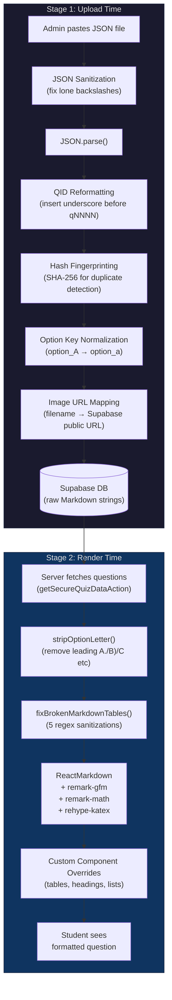

# Text Rendering Pipeline — Prepnova Education Platform

> A complete technical deep-dive into how text flows from the Admin's JSON upload all the way to the student's screen.

---

## Table of Contents

1. [Architecture Overview](#architecture-overview)
2. [Stage 1: Bulk Uploader — Text Transformations](#stage-1-bulk-uploader--text-transformations)
   - [1.1 JSON Sanitization (Backslash Escaping)](#11-json-sanitization-backslash-escaping)
   - [1.2 QID Reformatting (Underscore Insertion)](#12-qid-reformatting-underscore-insertion)
   - [1.3 Option Key Normalization](#13-option-key-normalization)
   - [1.4 Image URL Mapping](#14-image-url-mapping)
   - [1.5 Hash Fingerprinting](#15-hash-fingerprinting)
3. [Stage 2: RichText Renderer — Display Pipeline](#stage-2-richtext-renderer--display-pipeline)
   - [2.1 stripOptionLetter()](#21-stripoptionletter)
   - [2.2 fixBrokenMarkdownTables() — The 5-Step Sanitizer](#22-fixbrokenmarkdowntables--the-5-step-sanitizer)
   - [2.3 ReactMarkdown + Plugins](#23-reactmarkdown--plugins)
   - [2.4 Custom Component Overrides](#24-custom-component-overrides)
4. [Complete Data Flow Diagram](#complete-data-flow-diagram)

---

## Architecture Overview

Text flows through **two completely separate stages** at different points in time:

```
┌──────────────────────────────────────────────────────────────────┐
│                     STAGE 1: UPLOAD TIME                        │
│                                                                  │
│  Admin uploads JSON  ──→  Client-side validation & transforms   │
│                       ──→  Server-side processBulkUploadAction  │
│                       ──→  Stored in Supabase 'questions' table │
└──────────────────────────────────────────────────────────────────┘
                               │
                               │  (Raw Markdown strings sit in DB)
                               ▼
┌──────────────────────────────────────────────────────────────────┐
│                     STAGE 2: RENDER TIME                        │
│                                                                  │
│  Student opens quiz  ──→  Server fetches raw text from DB       │
│                      ──→  RichText component receives string    │
│                      ──→  fixBrokenMarkdownTables() sanitizes   │
│                      ──→  ReactMarkdown parses to HTML          │
│                      ──→  KaTeX renders math, GFM renders tables│
│                      ──→  Student sees formatted content        │
└──────────────────────────────────────────────────────────────────┘
```

> [!IMPORTANT]
> Stage 1 transforms are **destructive** (they permanently modify data before storage). Stage 2 transforms are **non-destructive** (they only affect display, the raw string in the DB is never touched).

---

## Stage 1: Bulk Uploader — Text Transformations

These transformations happen inside `AdminClient.jsx` → `BulkUploader` component and `bulkActions.js` server action.

---

### 1.1 JSON Sanitization (Backslash Escaping)

**Where:** `AdminClient.jsx`, lines 1383 and 1665

**What it does:** Fixes invalid JSON caused by unescaped backslashes from imported contents. Many LaTeX formulas contain single backslashes (like `\frac`) which are invalid in JSON strings.

**The Regex:**
```javascript
const sanitizedText = rawText.replace(/(?<!\\)\\(?!["\\/bfnrt])/g, '\\\\');
```

**How it works:** This uses a negative lookbehind `(?<!\\)` and a negative lookahead `(?!["\\/bfnrt])` to find lone backslashes that are NOT:
- Already escaped (`\\`)
- Part of a valid JSON escape sequence (`\"`, `\\`, `\/`, `\b`, `\f`, `\n`, `\r`, `\t`)

It then doubles them to make them valid JSON.

**Before → After:**

| Before (Raw JSON string) | After (Sanitized) |
|---|---|
| `"The formula is \frac{1}{2}"` | `"The formula is \\frac{1}{2}"` |
| `"Line 1\nLine 2"` | `"Line 1\nLine 2"` ← unchanged (valid `\n`) |
| `"Path: C:\Users\test"` | `"Path: C:\\Users\\test"` |
| `"Already \\escaped"` | `"Already \\escaped"` ← unchanged |

> [!NOTE]
> Without this fix, `JSON.parse()` would throw a `SyntaxError` on any question containing LaTeX math like `$\frac{x}{y}$`.

---

### 1.2 QID Reformatting (Underscore Insertion)

**Where:** `AdminClient.jsx`, line 1680–1683

**What it does:** Automatically inserts an underscore `_` before the trailing `qNNNN` suffix if one is missing. This enforces a consistent QID format across the database.

**The Regex:**
```javascript
const qidRegex = /(.*?[^_])(q\d+)$/i;
newQid = newQid.replace(qidRegex, '$1_$2');
```

**How it works:** The regex captures:
- `$1` = everything before the `q` suffix (but NOT ending in an underscore)
- `$2` = the `qNNNN` part itself

It only triggers when the character before `q` is NOT already an underscore.

**Before → After:**

| Input QID | Output QID | Changed? |
|---|---|---|
| `SAT2024_Mathq0001` | `SAT2024_Math_q0001` | ✅ Yes — missing underscore added |
| `SAT2024_Math_q0001` | `SAT2024_Math_q0001` | ❌ No — already has underscore |
| `CB_Englishq0045` | `CB_English_q0045` | ✅ Yes |
| `myquestion` | `myquestion` | ❌ No — doesn't end with `qNNNN` pattern |
| `test_q99` | `test_q99` | ❌ No — already has underscore before `q` |

> [!WARNING]
> This same regex is also applied to `image_url` filenames (line 1697–1706). If an image file is named `SAT2024q0001.png`, it gets renamed to `SAT2024_q0001.png` to match the corrected QID.

---

### 1.3 Option Key Normalization

**Where:** `bulkActions.js`, lines 52–71 (server-side)

**What it does:** Converts uppercase option keys from the JSON (`option_A`, `option_B`, etc.) to lowercase (`option_a`, `option_b`, etc.) to match the database schema.

**The Transform:**
```javascript
const { option_A, option_B, option_C, option_D, image_url, ...rest } = item;
return {
  ...rest,
  option_a: option_A || item.option_a,
  option_b: option_B || item.option_b,
  option_c: option_C || item.option_c,
  option_d: option_D || item.option_d,
  image_url: finalImageUrl
};
```

**Before → After:**

| Input JSON Field | Output DB Field |
|---|---|
| `"option_A": "3x + 5"` | `"option_a": "3x + 5"` |
| `"option_a": "3x + 5"` | `"option_a": "3x + 5"` ← already lowercase, passes through |

> [!NOTE]
> The fallback `option_A || item.option_a` means it accepts BOTH formats. If the JSON already uses lowercase keys, those pass through unchanged.

---

### 1.4 Image URL Mapping

**Where:** `bulkActions.js`, lines 54–61 (server-side)

**What it does:** If the JSON has `"image_url": "diagram.png"` (just a filename), and that image was uploaded to Supabase Storage, the filename gets replaced with the full public URL.

**Before → After:**

| Input `image_url` | Output `image_url` |
|---|---|
| `"diagram.png"` | `"https://xyz.supabase.co/storage/v1/object/public/question_images/public/diagram.png"` |
| `"https://already-a-url.com/img.png"` | `"https://already-a-url.com/img.png"` ← unchanged (no match in uploaded files) |
| `null` | `null` ← no transformation |

---

### 1.5 Hash Fingerprinting

**Where:** `AdminClient.jsx`, lines 17–44 and 1713–1714

**What it does:** Generates a SHA-256 hash of each question's content to detect duplicates across uploads. The hash formula differs between MCQ and SPR questions.

**MCQ Hash Formula (Standard):**
```
SHA-256( sorted_options_joined_by_pipe | correct_answer_text )
```

**MCQ Hash Formula (Restructured — when `is_restructured_hash = true`):**
```
SHA-256( sorted_options_joined_by_pipe | correct_answer_text | context | question )
```

**SPR Hash Formula:**
```
SHA-256( context | question )
```

**Example — Standard MCQ:**

Given a question with:
- Option A: `"were"`
- Option B: `"was"`
- Option C: `"are"`
- Option D: `"have been"`
- Correct Answer: `"A"` → text = `"were"`

```
Step 1: Sort options alphabetically (lowercased):  "are" | "have been" | "was" | "were"
Step 2: Append correct answer text:                 "are|have been|was|were|were"
Step 3: SHA-256 hash the result
```

> [!IMPORTANT]
> Sorting options means that even if two questions have the same choices in different order (A/B swapped), they'll produce the **same hash** and be flagged as duplicates. This is intentional — it catches reworded copies.

---

## Stage 2: RichText Renderer — Display Pipeline

These transformations happen inside `components/RichText.jsx` every time a question is rendered to a student (or in admin preview). The raw Markdown string from the database passes through several layers.

---

### 2.1 stripOptionLetter()

**Where:** `RichText.jsx`, lines 9–13. Called from `page.jsx` BEFORE text reaches the renderer.

**What it does:** Strips leading option letters (A, B, C, D) from option text, since the UI displays its own letter badges.

**The Regex:**
```javascript
text.replace(/^[A-D][.)]?\s+/, '');
```

**How it works:** Matches only at the START of a string (`^`):
- One letter from A–D
- Optionally followed by a `.` or `)`
- Followed by one or more spaces

**Before → After:**

| Input Option Text | Output | Stripped? |
|---|---|---|
| `"A. were"` | `"were"` | ✅ |
| `"B) was"` | `"was"` | ✅ |
| `"C are"` | `"are"` | ✅ |
| `"D.have been"` | `"D.have been"` | ❌ No space after `.` |
| `"Complex numbers"` | `"Complex numbers"` | ❌ Not A–D at start |
| `"All of the above"` | `"All of the above"` | ❌ "All" ≠ single letter + delimiter |
| `"A"` | `"A"` | ❌ No space follows |
| `"A "` | `""` | ✅ — "A " matches `A\s+` |

> [!CAUTION]
> **Edge case protection:** The regex requires a space after the letter/delimiter. This prevents stripping the "A" from words like "**A**cute" or "**A**ll" or "**C**omplex". Without the `\s+` requirement, real content starting with A–D would be destroyed.

---

### 2.2 fixBrokenMarkdownTables() — The 5-Step Sanitizer

**Where:** `RichText.jsx`, lines 15–40. Called inside the `RichTextBase` component before ReactMarkdown processes the string.

This function has **5 sequential regex transformations**, each fixing a specific type of corruption from imported content:

---

#### Step 0: Literal `\n` → Real Newline

```javascript
sanitized = text.replace(/\\n/g, '\n');
```

**Problem:** When JSON strings are copy-pasted from raw API responses, literal two-character `\n` sequences appear instead of actual newline characters.

**Before → After:**

```
BEFORE: "Line one\\nLine two\\nLine three"
         (displayed as one long line: "Line one\nLine two\nLine three")

AFTER:   "Line one
          Line two
          Line three"
         (three separate lines)
```

---

#### Step 0.5: Malformed LaTeX Degree Symbols

```javascript
sanitized = sanitized.replace(/\\\^\{\\circ\}/g, '^{\\circ}');
sanitized = sanitized.replace(/\\\^\\circ/g, '^\\circ');
```

**Problem:** Some imported contents double-escape the caret `^` in degree notation, producing `\^{\circ}` instead of `^{\circ}`.

**Before → After:**

| Before | After | Visual Result |
|---|---|---|
| `$90\^{\circ}$` | `$90^{\circ}$` | 90° |
| `$45\^\circ$` | `$45^\circ$` | 45° |
| `$90^{\circ}$` | `$90^{\circ}$` | unchanged (already correct) |

---

#### Step 1: Fix Concatenated Table Rows

```javascript
sanitized = sanitized.replace(/\|\s*\|/g, '|\n|');
```

**Problem:** imported contents sometimes smash table rows together, producing `||` or `| |` instead of separate lines.

**Before → After:**

```
BEFORE: "| Name | Score || Alice | 95 || Bob | 87 |"
         (Markdown sees this as ONE broken row)

AFTER:  "| Name | Score |
         | Alice | 95 |
         | Bob | 87 |"
         (Markdown sees THREE proper rows)
```

---

#### Step 2: Auto-Generate Table Captions

```javascript
sanitized = sanitized.replace(
  /(^|\n)([^|#\n][^\n]{2,})[\r\n]+(?=\s*\|.*\|[\r\n]+\s*\|[-:\s|]+\|)/g,
  '$1##### $2\n\n'
);
```

**Problem:** Many SAT questions have a title line above a table (like "Student Survey Results"). Markdown renders this as a plain paragraph with no visual distinction from body text.

**What the regex does:** It looks for:
1. A line of normal text (not starting with `|` or `#`)
2. That is immediately followed by a Markdown table header + separator row

It converts that plain text line into a `##### heading` (H5) — which the renderer then styles as a centered, bold caption.

**Before → After:**

```
BEFORE:
Student Survey Results
| Grade | Count |
|-------|-------|
| 9th   | 120   |

(renders as: a paragraph "Student Survey Results" then a table below it)


AFTER:
##### Student Survey Results

| Grade | Count |
|-------|-------|
| 9th   | 120   |

(renders as: a CENTERED BOLD CAPTION "Student Survey Results" then a table below it)
```

> [!NOTE]
> H5 (`#####`) was deliberately chosen because it's extremely unlikely to appear in normal SAT content. It acts as a private "tag" that only the custom renderer intercepts.

---

#### Step 3: Force Clean Table Breaks

```javascript
sanitized = sanitized.replace(/\|\s*[\r\n]+\s*([^|])/g, '|\n\n$1');
```

**Problem:** When a table ends and normal text follows on the next line, Markdown sometimes fails to detect the table's end — it tries to interpret the following text as more table rows, breaking the layout.

**Before → After:**

```
BEFORE:
| A | B |
|---|---|
| 1 | 2 |
The answer is 2.

(Markdown may try to parse "The answer is 2." as a table row → BROKEN)


AFTER:
| A | B |
|---|---|
| 1 | 2 |

The answer is 2.

(Double newline forces Markdown to close the table → CLEAN)
```

---

### 2.3 ReactMarkdown + Plugins

**Where:** `RichText.jsx`, lines 82–91

After `fixBrokenMarkdownTables()` sanitizes the string, it's passed to `ReactMarkdown` with three plugins:

```
Raw Markdown String
       │
       ▼
┌─────────────────────┐
│   remark-gfm        │  → Enables GitHub Flavored Markdown
│                     │     (tables, strikethrough, autolinks)
├─────────────────────┤
│   remark-math       │  → Detects $inline$ and $$block$$ math
│                     │     and marks them as math nodes
├─────────────────────┤
│   rehype-katex      │  → Converts math nodes to KaTeX HTML
│                     │     (renders actual math formulas)
└─────────────────────┘
       │
       ▼
  Rendered HTML
```

**What each plugin handles:**

| Syntax | Plugin | Rendered Output |
|---|---|---|
| `$x^2 + y^2 = z^2$` | remark-math + rehype-katex | Inline math: x² + y² = z² |
| `$$\frac{a}{b}$$` | remark-math + rehype-katex | Block math: centered fraction |
| `\| A \| B \|` | remark-gfm | HTML `<table>` |
| `~~strikethrough~~` | remark-gfm | ~~strikethrough~~ |

---

### 2.4 Custom Component Overrides

**Where:** `RichText.jsx`, lines 42–75

ReactMarkdown outputs generic HTML elements. The `markdownComponents` object intercepts specific elements and replaces them with styled versions:

| Element | Default HTML | Custom Override | Purpose |
|---|---|---|---|
| `table` | `<table>` | Wrapped in `<div className="overflow-x-auto">` + collapsed borders | Horizontal scroll on mobile, SAT-style clean borders |
| `th` | `<th>` | Dark background (`bg-gray-800`), white text, left-aligned | SAT-style dark header row |
| `td` | `<td>` | Bordered cells with padding | Clean data cells |
| `h5` | `<h5>` | Centered, bold, tracked text — **NOT a heading** | Table caption (from Step 2 regex) |
| `p` | `<p>` | Bottom margin with `last:mb-0` | Prevents extra space after the last paragraph |
| `ul` | `<ul>` | `list-disc` + padding restored | Tailwind's preflight removes list bullets — this restores them |
| `ol` | `<ol>` | `list-decimal` + padding restored | Same — restores numbered list styling |
| `li` | `<li>` | Left padding added | Consistent indentation |

> [!TIP]
> The `h5 → table caption` mapping is a deliberate design hack. It's the only "fake" semantic element in the system. All other overrides are cosmetic styling of real HTML elements.

---

## Complete Data Flow Diagram



---

> [!IMPORTANT]
> **Key Takeaway:** The database stores **raw Markdown** — never pre-rendered HTML. All visual formatting happens at render time through the `RichText` component. This means if you fix a bug in the renderer, ALL existing questions benefit immediately without re-uploading anything.
